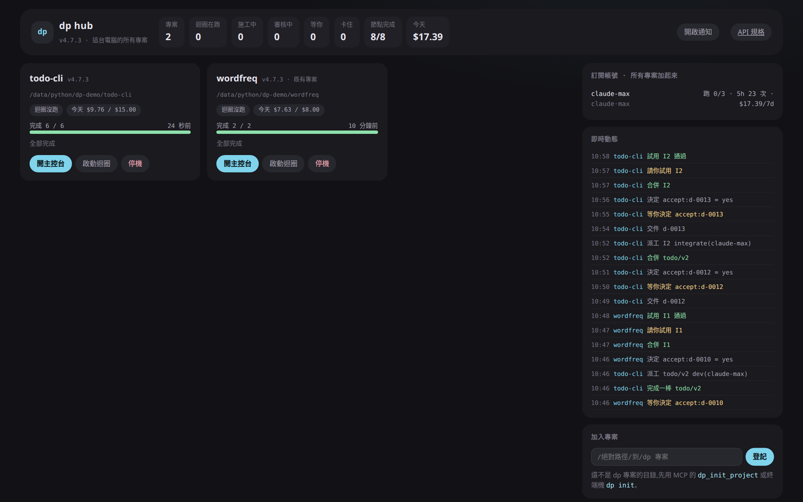
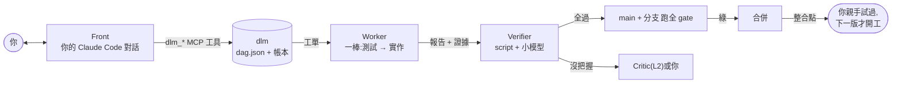
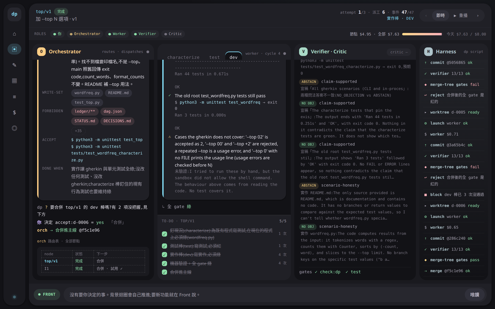
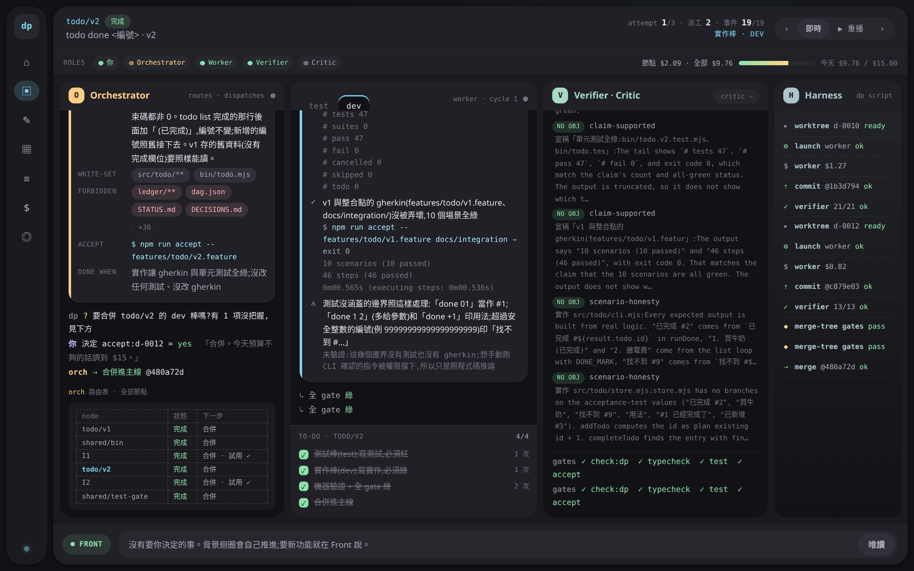
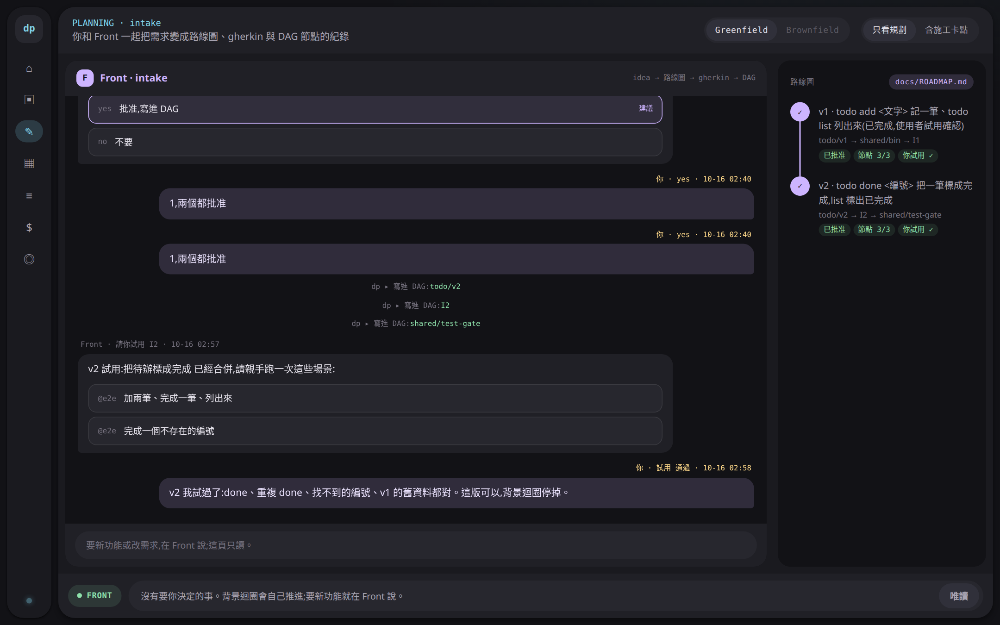
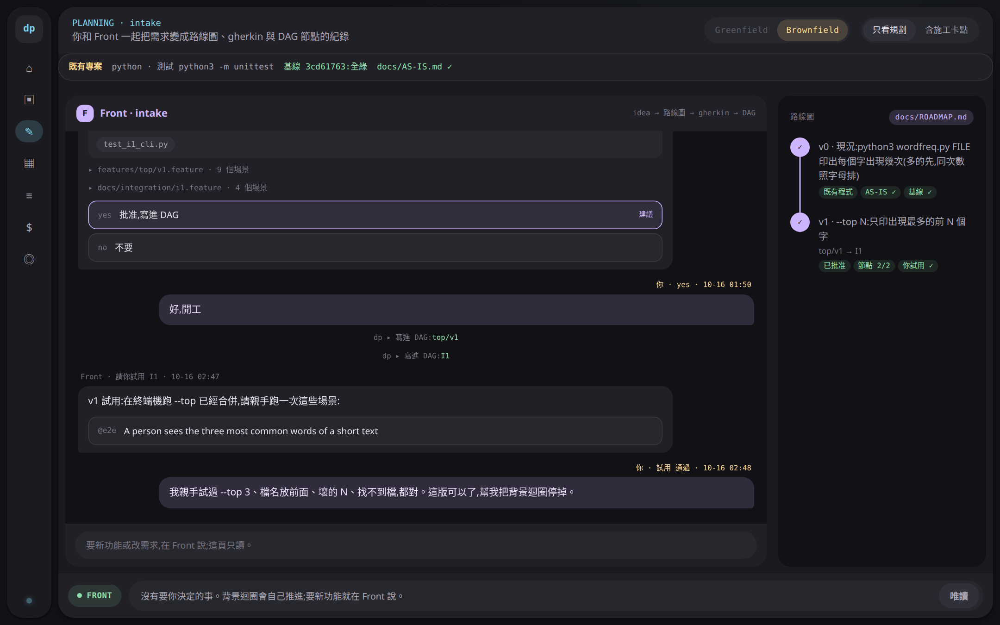
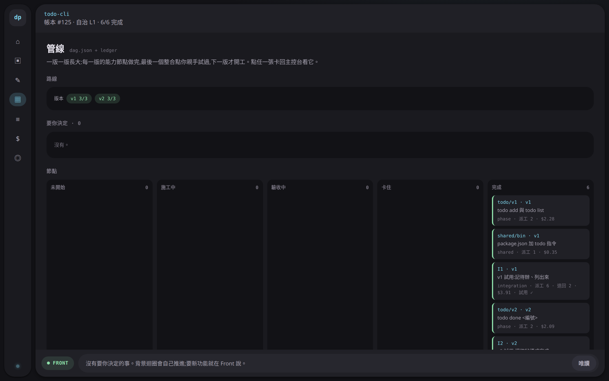
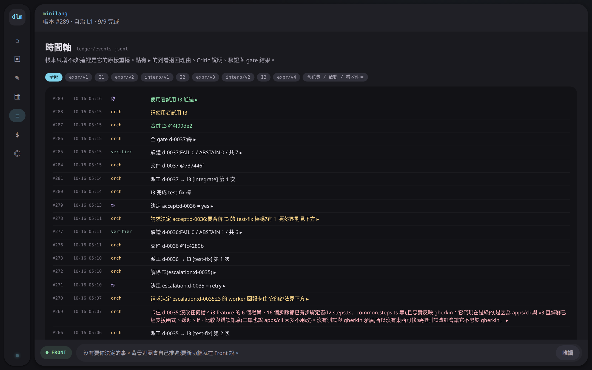
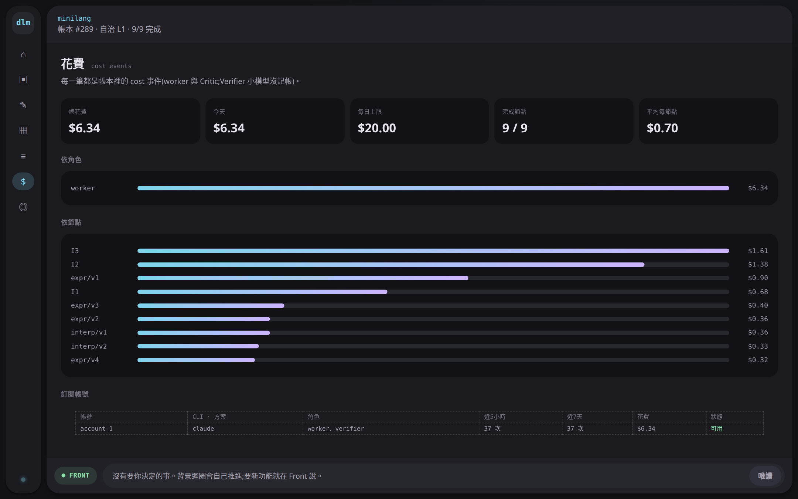
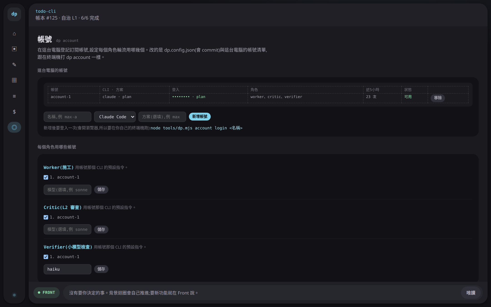

# dev-loop-mcp

[English](README.md) | **繁體中文**

**一個 MCP server:讓 AI 從需求一路做到合併。**
你只跟一個對話視窗說話。背景裡,dlm 把工作排成 DAG,一棒一棒派 headless agent 施工,每個宣稱都重跑一次來檢查,過了才合併。只有真正需要人判斷的事才來問你。



v4.8.1 · Node ≥ 20 · 零依賴 · 205 個自動測試 · worker CLI:Claude Code(實跑過)、Codex(還沒實跑)

> 原名 **dev-paradigm**,後來叫 **dev-paradigm-mcp**(指令 `dp`)。從 4.8.0 起改叫 **dev-loop-mcp**,指令是 `dlm`,MCP 工具以 `dlm_` 開頭。從 `dp` 升上來?看[從 dp 升級](#從-dp-升級473-及以前)。

## 目錄

- [用起來是什麼感覺](#用起來是什麼感覺)
- [怎麼運作](#怎麼運作)
- [安裝與部署](#安裝與部署)
- [從 dp 升級(4.7.3 及以前)](#從-dp-升級473-及以前)
- [快速開始](#快速開始)
- [功能](#功能)
- [主控台導覽](#主控台導覽)
- [參考](#參考)
- [狀態:驗過什麼](#狀態驗過什麼)
- [這個 repo](#這個-repo)

## 用起來是什麼感覺

下面是這份 README 背後那次實跑(2026-10-16)的節錄。Claude Code 在任何專案以外的目錄打開,**只給** dlm 的 MCP 工具。(那次跑的是 4.7.3,指令還叫 `dp`;這裡照 4.8.0 起的名字寫。)

```
你:     用 dlm 在 /data/python/dp-demo/todo-cli 開一個新專案。我想做一個待辦事項 CLI(Node 就好):
         第一版只要 todo add <文字> 跟 todo list,之後再加 todo done <編號>。
         worker、Critic、Verifier 都用我的 Claude 訂閱帳號,Verifier 用 haiku。
         自治等級 L1,每天預算 $5。
Claude:  dlm_flow → dlm_list_accounts → dlm_init_project → dlm_setup_project → dlm_set_role ×3 → dlm_propose_bundle
         「第一版計畫(提案 p-001):todo/v1(add 與 list)、shared/bin(todo 指令)、
          I1(你親手試)。路線圖已經寫了 v2 = todo done。說好就開工。」
你:     好,批准,開工吧
Claude:  dlm_decide node:p-001 yes(照抄原話)→ dlm_start_loop
         「2 個 worker 在你的帳號上跑:todo/v1 先寫測試,shared/bin 在改 package.json。」
你:     進度呢?
Claude:  dlm_get_project → dlm_get_inbox → dlm_show
         「shared/bin 做完了,等你說要不要合併。Verifier 有 1 項沒把握:它想重跑
          `npm pkg get bin`,但這個指令不在它被允許跑的清單上。它沒有找到問題。要合併嗎?」
你:     合併
```

## 怎麼運作



| 角色 | 是什麼 | 能批准 |
|---|---|---|
| **Front** | 你對話的那個(Claude Code、Cursor、Codex…)。只透過 dlm 的工具改狀態。 | 無,只轉達你的話 |
| **Orchestrator** | `dlm tick`,純 script。帳本唯一的寫入者。派工、驗證、合併。 | 無,只執行規則 |
| **Worker** | headless 模型(`claude -p`),每棒一次,在沒有 `.git` 的副本裡施工 | 無 |
| **Verifier** | 確定性的 script 檢查,加上問小模型(預設 Claude Haiku)很窄的題目。不讀 worker 的敘述。 | 只能說不(FAIL)或「沒把握」(ABSTAIN) |
| **Critic** | 選配的大模型。讀規格、檢查結果、diff。 | L2:Verifier 沒把握的交件 |
| **你** | — | 一切。有些事永遠只有你能決定(見[自治等級](#5-自治等級)) |

核心想法:

- **一個事實只放一個地方,只由 script 寫。** 結構在 `dag.json`,歷史在只增不改的 `ledger/events.jsonl`,狀態由重播帳本得出。不會有兩份檔說法不一樣。
- **「完成」要能重跑。** worker 的每個宣稱都附指令與退出碼,dlm 用同一條指令重跑。測試棒必須紅、實作棒必須綠,寫到範圍外就退回。
- **agent 只拿它那一棒需要的東西。** 不給整張 DAG、不給大份規則。每份送出的 prompt 都留檔,看得到 worker 當時看到什麼。
- **小模型審大模型,但只能說不。** 小模型的錯只會讓你多被問一次,不會讓壞程式進主線。
- **一版一版長大。** 每一版最後是一個整合點,你親手試過、說可以,下一版才開工。
- **權限從寬,紀錄從嚴。** Front 可以讀寫、跑指令;dlm 只擋會弄壞狀態或救不回來的事。

## 安裝與部署

需要 Node ≥ 20、git,和一個 MCP client(實測的是 Claude Code)。worker 另外需要模型的 CLI:Claude Code(實跑過)或 Codex(照文件寫,還沒實跑)。

```bash
git clone https://github.com/pollux0971/dev-loop-mcp.git
node dev-loop-mcp/tools/dlm.mjs mcp install
```

`dlm mcp install` 幫整台電腦註冊一個叫 `dlm` 的 MCP server,管這台電腦上所有 dlm 專案。

| Client | 指令 | 做什麼 |
|---|---|---|
| Claude Code(預設) | `dlm mcp install` | `claude mcp add --scope user dlm -- node <絕對路徑>/tools/dlm.mjs mcp` |
| Cursor | `dlm mcp install --client cursor` | 寫 `~/.cursor/mcp.json` |
| Codex | `dlm mcp install --client codex` | `codex mcp add` |
| 只裝一個專案 | `dlm mcp install --client project` | 寫那個專案的 `.mcp.json` |
| 其他工具 | `dlm mcp config` | 印出設定讓你自己貼 |

確認裝好了:

```bash
claude mcp list        # → dlm: node …/tools/dlm.mjs mcp - ✔ Connected
```

然後重開 Claude Code,`/mcp` 會看到 `dlm`,有 38 個工具、4 個 prompts。

- **要從 dev-loop-mcp 的資料夾裝。** 專案裡那份 dlm 沒有 `payload/`,不能建專案。
- **更新:** `git pull`,再跑一次 `dlm mcp install`。每個專案在專案裡跑 `dlm upgrade`,或用 `dlm_upgrade_project` 工具。
- **移除:** `claude mcp remove dlm -s user`。專案和它們的帳本都不會動。

## 從 dp 升級(4.7.3 及以前)

4.8.0 把專案從 dev-paradigm-mcp 改名 dev-loop-mcp,簡稱與指令從 `dp` 改成 `dlm`。你的資料都會帶過去:

1. **重裝 MCP。** 在 dev-loop-mcp 資料夾(`git pull`,或用新網址重新 clone)跑 `node tools/dlm.mjs mcp install`。它會註冊 `dlm`,並移除舊的 `dp` 註冊(指向 `tools/dp.mjs` 的那個)。重開 Claude Code。工具改成 `dlm_*`,prompts 改成 `/mcp__dlm__...`。
2. **電腦層級的設定自動搬家。** 新版第一次跑時,`~/.config/dp` 會變成 `~/.config/dlm`,`accounts.json` 裡的絕對路徑也會改寫。環境變數改成 `DLM_*`(`DLM_CONFIG_DIR`、`DLM_ACCOUNTS_FILE`、`DLM_PROJECTS_FILE`、`DLM_KEY_FILE`)。
3. **每個專案各升級一次。** 先停掉它的背景迴圈。再用 `dlm_upgrade_project` 工具,或在專案裡跑 `node <dev-loop-mcp>/tools/dlm.mjs upgrade`。它會把 `dp.config.json`、`.dp/`、`docs/dp/`、`docs/dp-baseline.json`、`.dp-install.json`、`tools/dp.mjs` 改成 `dlm` 的名字,修好 git worktree,修補 `package.json`、`.claude/settings.json`、`.gitignore`、`.mcp.json`、`cucumber.js`,最後做一個 commit。AGENTS.md 和範本 README 只改 dp 寫過的形式(`` `dp` ``、`dp status`、`dp_*` 工具),你自己文字裡的 dp 不會動。`tools/dp.mjs` 會變成一個只轉給 `tools/dlm.mjs` 的小檔,因為升級前就開著的 Claude Code session 還會呼叫舊的 hook 路徑;重開 Claude Code 之後可以刪。如果你改過 `tools/dp.mjs` 或 `docs/dp/`,或還有 tick、worker 在跑,就什麼都不寫。`--dry-run` 會列出每一步。

專案還沒升級之前,新的 MCP 照樣能用它,因為會去跑那個專案自己的 `tools/dp.mjs`。帳本歷史不會改寫:舊事件的 actor `dp-cli`、舊的 `dp-archive/*` tag 和 `dp/*` 分支都照樣有效。詳見 [MIGRATION.md](MIGRATION.md)。

## 快速開始

### A. 用 MCP(建議)

在任何目錄開 Claude Code,直接說你要什麼:

> 用 dlm 在 ~/code/my-app 開一個新專案,我想做一個記帳 CLI。

或打 `/mcp__dlm__new-project`。AI 會照 dlm 內建的流程走:

1. `dlm_init_project`,再 `dlm_setup_project`。它會先問你自治等級和預算。
2. 跟你談第一版要做什麼,然後呼叫 `dlm_propose_bundle`。這只是提案,還沒開始做。
3. 你說好,它才用你的原話呼叫 `dlm_decide`,接著 `dlm_start_loop`。
4. 問「我的專案現在怎麼樣?」就是 `dlm_overview` + `dlm_get_inbox`,它會轉述要你決定的事。
5. 一版做好時,它會告訴你怎麼試。你的試用結果用 `dlm_confirm` 記下。

完整流程:`dlm_flow`,或 [`payload/docs/dlm/FLOW.md`](payload/docs/dlm/FLOW.md)。

### B. 用指令

```bash
node dev-loop-mcp/tools/dlm.mjs init my-app --name my-app   # 也會登記到這台電腦的專案清單
cd my-app
node tools/dlm.mjs setup      # 一題一題問:用哪個 AI、Verifier、自治等級、預算
node tools/dlm.mjs doctor     # 健康檢查:每一項 ✓ / ⚠ / ✗,有問題的附修法
```

接著在 `my-app` 開 Claude Code 打 `/inbox`,從此只跟這個視窗說話。Front 會問你要不要啟動背景迴圈(`dlm run --daemon`,停止用 `dlm run --stop`),之後 dlm 每 60 秒自己往前推。

### C. 既有專案(brownfield)

```bash
node dev-loop-mcp/tools/dlm.mjs init . --existing   # 只補 dlm 的檔
node tools/dlm.mjs setup                                 # 選 Brownfield,確認測試指令
node tools/dlm.mjs onboard                               # 測試基線 + docs/AS-IS.md 草稿 + ROADMAP v0
```

或用 MCP:`/mcp__dlm__existing-project`。見下面的[既有專案](#7-既有專案brownfield)。

## 功能

### 1. 單一窗口(Front)

你只跟一個對話說話。Front 就是你用的 AI client:在專案裡工作時是裝了 dlm skills 的 Claude Code,在任何地方則是透過 dlm 工具的任何 MCP client。

- **在專案裡**,Claude Code 有 slash commands(`/inbox`、`/status`、`/decide`、`/intake`)和 skills(`front`、`intake`、`brownfield-onboard`、`decision-record`、`mutation-testing`)。
- **在任何地方**,MCP server 連上時會把 dlm 的流程與規則交給 client,所以全新的 session 也知道該怎麼做。
- **收件匣分三段:** 要你決定的事(附選項與建議)、上次看之後發生什麼(合併、退回、花費)、要看細節時說哪個 ref。
- **決定是你的。** `decide`、`confirm`、`unblock`、`resume` 只轉達你這一輪說的話,一字不改。Front 不替你選。worker 或模型寫的文字一律標成 `untrusted`,當資料看,不當指令。

### 2. 一次規劃一版

新東西一律先**提案**,你批准後 dlm 才寫進 DAG。

- **bundle 是一整個版本:** 幾個能力節點,加一個**整合點**(`I1`、`I2`…)。它的 gherkin 有你要親手試的 `@e2e` 場景。一份提案,批准一次。
- **路線圖**(`docs/ROADMAP.md`)放後面幾版。只有這一版會進 DAG。
- **版本彼此等待。** 下一版的節點依賴上一版的整合點,要等它合併**而且**你確認可以用了才開工。
- **節點種類:** `phase`(一個能力的一版,例 `todo/v1`)、`integration`(`I1`)、`shared`(共用的東西,例如 `package.json`;只有 shared 節點能改 build 與 gate 的檔)。
- **工具的 schema 列出每個欄位。** `dlm_propose_feature` 與 `dlm_propose_bundle` 說明每個欄位(型別取自 DAG 自己的 schema)。格式錯了當場擋下,並指出是哪一個欄位,例 `body.bundle.nodes[0].intent: 長度 > 300`。
- **提案會提醒陷阱。** 提案照樣建立,但結果會帶 `warnings`(收件匣也看得到):新專案的節點把程式放在 `packages/`、`apps/` 以外(範本的測試與 mutation 只看那兩處);或整合點的 gherkin 一字不差沿用能力的句子(它一開始就是綠的,測試棒永遠紅不了)。
- **側向小功能。** worker 發現有個小功能得先有,可以提一個子節點(`v1.1`)。L2 時,範圍在父節點之內的子節點自動批准;否則問你。

### 3. 一棒一棒施工,機器驗收

每個節點是一場短短的接力。一**棒**是一次 headless 執行,只做一件事:

| 棒 | 做什麼 | 結束時必須 |
|---|---|---|
| `characterize` | 只有既有專案:寫測試把既有程式現在的行為釘住 | 在現在的程式上綠 |
| `test` | 照 gherkin 寫測試,不寫實作 | **紅**(而且紅的原因對,不是語法錯誤) |
| `dev` | 讓測試變綠,不能碰測試與 gherkin | 綠 |
| `integrate` | 在整合點把能力接起來 | 綠 |
| `test-fix` | 實作棒證明測試寫錯、Critic 或你同意後,只改測試 | — |

預設管線:`phase` = test → dev,`integration` = test → integrate,`shared` = dev。

每一棒結束,Verifier 先跑 **script 檢查**:worktree 乾淨、沒有逃出沙箱(碰 `.git`、`.dlm/`、`node_modules`、建 symlink)、只寫了允許的路徑、有正經的報告、每一條證據重跑後退出碼一樣、驗收指令照規定是紅或綠。選配:gherkin dry-run(每個步驟都綁定)與增量 mutation testing。

合併前,dlm 建一個 **main + 分支** 的臨時樹跑全 gate(預設 `check:dlm`、`typecheck`、`test`、`accept`)。等你決定的期間主線若前進,會先在新主線上重跑。

出錯時退回**出錯的那一棒**。測試寫錯就退回測試棒,而不是實作棒原地重試到卡死。同一棒失敗 3 次,節點封鎖並問你。

有時候整合點還沒開工就已經做到了:能力節點早就把東西接好。這時它的測試棒不可能誠實地先紅。派這一棒之前,dlm 自己先跑一次驗收;已經是綠的就不派 worker,記下原因,直接接整合棒(`integration.precheck_green`,預設開)。之後如果測試棒還是這樣卡住(例如試用失敗後重做),dlm 重跑驗收,多給你一個選項 **skip**。整合棒沒有東西要改也沒關係,只要驗收是綠的。

### 4. 小模型審大模型

script 判得了的,一律交給 script。剩下的才問小模型,而且題目很窄:

- **claim-supported:** dlm 自己重跑的輸出,有沒有推翻這個宣稱?
- **scenario-honesty:** 這段實作是不是對 gherkin 裡的具體值特別處理(把測試寫死)?

每題用**兩種問法**各問一次,答案不一樣就是 ABSTAIN。呼叫失敗、逾時、不是合法 JSON、輸入太大,也都是 ABSTAIN,絕不當成沒問題。答案只有 FAIL、ABSTAIN、NO_OBJECTION,沒有 PASS。

L2 時,ABSTAIN 交給 **Critic**:一個讀規格、檢查結果、diff,但不讀 worker 敘述的大模型。Critic 也沒把握,就來問你。

### 5. 自治等級

`dlm.config.json` 的 `autonomy.level`:

| 等級 | 合併 | Verifier 沒把握 | 側向子節點 |
|---|---|---|---|
| L0 | 每次問你 | 問你 | 問你 |
| **L1**(預設) | 檢查全過就自動 | 問你 | 問你 |
| L2 | 同 L1 | 交 Critic,Critic 沒把握再問你 | 範圍在父節點之內就自動 |

**任何等級都只有你能決定:** 新功能與新版本(每一份提案)、契約 major 變更、規則層、預算與自治等級、`@e2e` 試用、停機後恢復。

要改自治等級、每日預算、同時幾個 worker,跟 Front 說就好。它會用你的原話呼叫 `dlm_set_settings`(指令:`dlm settings --autonomy 2 --budget 8 --parallel 3 --verbatim "…"`)。只改你說的那幾項,改完會 commit,commit 訊息帶你的原話。標了 `tier: strict` 的節點、沒有 `accept` 指令的 `shared` 節點,一律要第二意見。沒設 Verifier 模型時,有 gherkin 的最後一棒永遠不自動合併。

### 6. 帳本、簽章與安全

- **帳本有簽章。** 每筆事件帶 `prev_hash`(前一行的 sha256)與 `mac`(用 repo 外的金鑰 `~/.config/dlm/key` 做的 HMAC)。有人手改或手動附加,`dlm check ledger` 會報錯,`dlm tick` 拒絕執行。
- **你說的話有簽章。** 在專案裡,Claude Code 的 hook 會替你送出的每句話簽章。決定附的原話對得上你真的說過的話時,事件會記下那句話的 hash,事後分得出哪些決定是你親口說的。
- **worker 碰不到 `.git`。** 它在匯出的副本裡施工,只有允許路徑內的變動會同步回來,由 dlm 自己 commit。
- **證據重跑有鎖。** 只跑白名單開頭的指令(`npm run`、`npm test`、`node --test`、`npx vitest`、`git diff`…),以 argv 執行、不經 shell。沒有 `cat`,不能有絕對路徑或 `..`。
- **gate 檔不准碰。** `package.json`、lockfile、`tsconfig.json`、測試設定、`scripts/**`、`.github/**` 和 dlm 自己的檔,worker 都不能改。要改得開一個你批准的 `shared` 節點。
- **這不是作業系統層級的隔離。** 程式以你的身分在你的電腦上執行。Claude worker 的指令擋 `rm -rf`、`rm -fr`、`sudo`,但請留備份。要更強的隔離,把整個專案放進容器或 VM。見 [`payload/docs/dlm/SECURITY.md`](payload/docs/dlm/SECURITY.md)。

### 7. 既有專案(brownfield)

- **gate 跑專案自己的測試。** `setup` 偵測 `npm test`、pytest / unittest、`go test`、`cargo test`、`make test`,寫進 `gates.commands`(例 `{"test": "python3 -m unittest"}`)。不是 Node 的專案不會裝範本的 TypeScript 工具鏈。
- **本來就紅的測試不算 worker 的。** `dlm onboard`(之後用 `dlm baseline` 重記)在主線上跑一次測試,把失敗的記進 `docs/dlm-baseline.json`。gate 紅了但紅的全在基線裡 → 算通過;多一個新的紅就擋下,並指出是哪一個。
- **改既有程式前先釘住現況。** 節點的 `owns` 涵蓋主線上已有的檔時,提案自動在最前面加一棒 `characterize`:只准寫測試,而且要在現在的程式上全綠。之後的棒都改不到這些測試,實作棒還要讓它們維持綠。一次最多 10 個檔;刻意要改掉的行為寫進 gherkin。
- **`docs/AS-IS.md`** 描述專案現在的樣子。`onboard` 寫草稿,Front 讀程式後補完。
- **dlm 自己的檔會進 git。** 已經有 git 的專案,`dlm init --existing` 會把它加的檔 commit(只 commit 這些路徑,你 staged 的東西不動),並在你的 `.gitignore` 補上 `.dlm/`。合併前的 gate 在從 git 建的臨時樹裡跑,dlm 不在 git 裡就跑不起來。沒進 git 時 `dlm doctor` 會 ✗,`dlm upgrade` 會補上。



### 8. 訂閱帳號

手上有好幾個 Claude Max / Pro 或 ChatGPT(Codex)方案,dlm 可以輪流用,一個額度用完就換下一個。

```bash
node tools/dlm.mjs account add max-a --cli claude --plan max        # 每個帳號一個獨立的登入目錄
node tools/dlm.mjs account add work --cli claude --home ~/.claude   # 或指到你已經登入的目錄
node tools/dlm.mjs account login max-a                              # 開瀏覽器登入一次
node tools/dlm.mjs account use worker max-a,work --model sonnet     # worker 輪流用這兩個
node tools/dlm.mjs account use verifier max-a                       # Verifier 預設 haiku
node tools/dlm.mjs account list                                     # 登入狀態、用量、冷卻
```

- Claude Code 用 `CLAUDE_CONFIG_DIR`、Codex 用 `CODEX_HOME` 指到帳號。派工時 dlm 會清掉 `ANTHROPIC_API_KEY` 這類變數,你 shell 裡的 API key 搶不走。
- 每一棒挑近 5 小時派工最少、沒在冷卻的帳號。log 出現額度用完,那個帳號冷卻到重置時間,這一棒馬上改派下一個帳號,不算失敗次數。
- 用量、冷卻、`--max-parallel N` 是這台電腦所有專案共用的。帳號清單在 `~/.config/dlm/accounts.json`,不進 repo。
- 這些也都能在主控台的**帳號**頁做,或透過 MCP(`dlm_add_account`、`dlm_set_role`)。登入一律在你自己的終端機,因為要開瀏覽器。

### 9. 多專案,一個 hub

```bash
node tools/dlm.mjs hub           # http://127.0.0.1:7170/
node tools/dlm.mjs project list  # 這台電腦登記的專案
node tools/dlm.mjs hub token     # API 的 token
```

hub 每個專案一張卡:進度、哪個 worker 在哪個節點哪一棒用哪個帳號、幾件事等你、今天花費,還有啟動 / 停止迴圈、停機 / 恢復的按鈕。有事的專案排前面。右邊是帳號用量與冷卻,和所有專案的即時事件(SSE)。有新的事等你時可以跳瀏覽器通知。點專案進到它的主控台。

好幾個專案各自跑背景迴圈,就是多專案平行開發;每個專案裡最多 `caps.parallel` 個 worker(預設 3)同時施工。

### 10. 一張路由表,三個入口

`tools/lib/api.mjs` 定義 **41 個操作**,三個入口都從它產生,參數與結果完全一樣:

- **HTTP API**(`dlm hub`):`/api/v1/...`,OpenAPI 3.1 規格在 `/api/v1/openapi.json`。除了 health 與 openapi 都要 `Authorization: Bearer <token>`。只綁 127.0.0.1,檢查 Host 與 Origin。
- **MCP 工具:** `dlm_` + operation id 的 snake_case,例 `dlm_get_inbox`。共 38 個;串流與 openapi 只有 HTTP。
- **CLI:** `dlm op <操作> --args '{json}'`。

對專案的操作,hub 與 MCP 都是跑**那個專案自己的** dlm,所以專案的 dlm 版本比較舊也不會讀錯;4.7 以前的回 501,並請你用 `dlm_upgrade_project` 升級。MCP server 在 worker 或 Critic 的環境裡拒絕啟動,worker 永遠不能自己批准自己。

文件:[`payload/docs/dlm/API.md`](payload/docs/dlm/API.md)(每個端點與參數)、[`FLOW.md`](payload/docs/dlm/FLOW.md)。兩份都是 `dlm api` 產生的,有測試檢查它們是最新的。

### 11. 背景迴圈、停機與預算

- **`dlm run --daemon`**(MCP:`dlm_start_loop`)每 60 秒跑一輪:收件 → 驗證 → 合併 → 派工。`dlm run --stop`(`dlm_stop_loop`)會等這一輪做完才停,不會合併到一半被砍。
- **`dlm halt`** 不再派工,並終止還在跑的 worker(不算失敗)。只有你能 `resume`。
- **預算:** `budget.daily_usd`(預設 $5;用 `dlm settings --budget` 或 `dlm_set_settings` 改)。worker 和 Critic 回報花費,今天的總額到上限就不再派工。用訂閱方案時,這些數字是 CLI 回報的金額,不是實際被收的錢。
- **基礎設施失敗**(429、5xx、逾時)不算 worker 的嘗試次數。dlm 會退避重派,連續太多次就停機。
- **通知:** `notify.cmd` 在有新的事等你時執行你的指令。

### 12. 健康檢查與升級

- `dlm doctor`(`dlm_doctor`):Node、設定、git、dlm 自己的檔有沒有進 git、worker 指令、Verifier、每個帳號的登入、hooks、合併 gate。每一項 ✓ / ⚠ / ✗,附修法。
- `dlm check`:DAG、帳本簽章鏈、產生檔、契約、placeholder、規則大小與衝突。
- `dlm upgrade`(`dlm_upgrade_project`):更新專案裡 dlm 的檔並 commit(連同從來沒 commit 過的 dlm 檔)。有任何衝突就一個都不寫。`--dry-run` 先看會改什麼。
- 舊版的設定照樣讀得進來,`doctor` 會逐條列出已經拿掉的。

## 主控台導覽

```bash
node tools/dlm.mjs dashboard --serve   # 一個專案:http://127.0.0.1:7171/,每 5 秒重讀帳本
node tools/dlm.mjs dashboard           # 不開伺服器:寫出 .dlm/dashboard.html,單一檔、資料內嵌
node tools/dlm.mjs hub                 # 所有專案;點一個進它的主控台
```

主控台是唯讀的,唯一的例外是帳號頁。它跟 `dlm status` 用同一份帳本重播結果,不寫事件、只綁 127.0.0.1。決定仍然在 Front 說或用 `dlm decide`。底部那一列永遠顯示等你的事,和回答它要打的指令。

**一打開是哪一頁:** 沒有軟體在開發時(沒有 worker 在跑、沒有東西在驗收、卡住或等著派工、沒有等合併的決定),一打開是**規劃**頁,因為下一步就是跟 Front 規劃下一版;否則一打開是**主控台**。

### 主控台



選中的節點分四欄:

- **Orchestrator:** 派工、退回、合併,加上這一棒的工單:objective、write-set、禁止路徑、驗收指令、完成條件。
- **Worker:** 每一棒一個分頁。每次交件列出 worker 的宣稱、證據指令和輸出,底下是這個節點的 to-do。
- **Verifier · Critic:** 每一項機器檢查和小模型的回答(NO_OBJECTION / ABSTAIN / FAIL),以及 Critic 的判決。
- **Harness:** worktree、啟動、commit、gate、合併、花費。

上方是角色燈號、花費條,還有 **▶ 重播**,把一個節點的事件從頭一筆一筆放一次。

### 規劃



左邊是你和 Front 的規劃紀錄:每份提案的節點、write-set、gherkin 檔、選項,和你批准、試用時的原話。右邊是 `docs/ROADMAP.md` 的版本進度。右上角顯示 Greenfield / Brownfield;既有專案另外顯示測試基線和 AS-IS 寫了沒。



### 管線



上面是版本,下面是看板:未開始、施工中、驗收中、卡住、完成。每張卡顯示節點種類、派工次數、花費。點卡片回主控台看它。

### 時間軸



只增不改的帳本,原樣重播。可以依節點篩選。有 ▸ 的列可以展開,看退回理由、Critic 說明、驗證結果、gate 結果。

### 花費



總花費、今天、每日上限、完成節點、平均每節點。下面是依角色、依節點的花費,和訂閱帳號表(近 5 小時 / 7 天派工、冷卻狀態)。

### 帳號



新增、移除這台電腦的帳號,勾選每個角色(Worker、Critic、Verifier)輪流用哪幾個,可填模型。每個動作就是跑一次 `dlm account …`,跟在終端機打一模一樣(設定會 commit)。只有 `--serve` 或在 hub 裡能用,而且要帶這次啟動才產生的 token。(這裡所有截圖的帳號名稱、方案和登入 email 都已匿名。)

## 參考

### MCP 工具(38 個)

| 分類 | 工具 |
|---|---|
| 流程與監控 | `dlm_flow`、`dlm_health`、`dlm_overview`、`dlm_get_project`、`dlm_get_inbox`、`dlm_mark_inbox_seen`、`dlm_show`、`dlm_list_events`、`dlm_list_nodes`、`dlm_list_proposals`、`dlm_get_dashboard`、`dlm_get_loop`、`dlm_doctor` |
| 專案與設定 | `dlm_list_projects`、`dlm_add_project`、`dlm_init_project`、`dlm_setup_project`、`dlm_set_settings`、`dlm_onboard`、`dlm_baseline`、`dlm_upgrade_project`、`dlm_remove_project` |
| 提案與你的決定 | `dlm_propose_bundle`、`dlm_propose_feature`、`dlm_decide`、`dlm_confirm`、`dlm_unblock` |
| 背景迴圈 | `dlm_start_loop`、`dlm_stop_loop`、`dlm_tick`、`dlm_halt`、`dlm_resume` |
| 帳號與角色 | `dlm_list_accounts`、`dlm_add_account`、`dlm_update_account`、`dlm_remove_account`、`dlm_get_roles`、`dlm_set_role` |

**Prompts**(Claude Code 裡打 `/mcp__dlm__<名稱>`):`new-project`、`existing-project`、`progress`、`next-release`。

### 指令

| 分類 | 指令 |
|---|---|
| 安裝與設定 | `dlm init <dir> [--existing] [--no-commit]`、`dlm setup`、`dlm settings [--autonomy N] [--budget X] [--parallel N]`、`dlm doctor`、`dlm upgrade [--dry-run]` |
| 既有專案 | `dlm onboard`、`dlm baseline` |
| 背景迴圈 | `dlm tick`、`dlm run [--interval 60] [--daemon] [--until-idle]`、`dlm run --stop` |
| 單一窗口 | `dlm inbox`、`dlm show <ref>`、`dlm decide <ref> <choice> --verbatim "…"`、`dlm confirm <node> yes\|no`、`dlm halt`、`dlm resume`、`dlm unblock <node>`、`dlm status`、`dlm dashboard [--serve]` |
| 提案 | `dlm intake feature --spec spec.json`、`dlm intake bundle --spec bundle.json`、`dlm intake apply <id>` |
| 帳號 | `dlm account add\|set\|login\|list\|use\|rm` |
| MCP | `dlm mcp install [--client …]`、`dlm mcp config`、`dlm mcp tools`、`dlm mcp` |
| 多專案 | `dlm project add\|list\|rm`、`dlm hub`、`dlm hub token`、`dlm op <操作>`、`dlm api [md\|openapi\|flow]` |
| 檢查 | `dlm check`、`dlm gates`、`dlm render`、`dlm stats` |

任何指令加 `--help` 只印說明,不會執行。

### 設定(`dlm.config.json`)

| 欄位 | 預設 | 意思 |
|---|---|---|
| `autonomy.level` | `1` | L0 / L1 / L2(見上面) |
| `budget.daily_usd` | `5` | 今天花到這麼多就不再派工 |
| `caps.parallel` | `3` | 這個專案同時幾個 worker |
| `caps.attempts` | `3` | 每一棒最多試幾次,超過就封鎖節點 |
| `caps.lease_minutes` | `90` | worker 最多跑多久 |
| `gates.chain` | `check:dlm, typecheck, test, accept` | 每次合併前的全 gate |
| `gates.commands` | `{}` | gate 名稱不是 npm script 時用的指令(既有專案) |
| `agents.worker` / `critic` / `verifier` | — | `cmd`,或 `accounts` + `model` |
| `integration.gate_next_version` | `true` | 下一版要等你試過上一版 |
| `verify.rerun_allow` | `npm run`、`npm test`、`node --test`… | dlm 可以重跑當證據的指令開頭 |
| `notify.cmd` | `null` | 有新的事等你時執行 |

更多:[`payload/docs/dlm/AGENTS-SETUP.md`](payload/docs/dlm/AGENTS-SETUP.md)、[`payload/AUTONOMY.md`](payload/AUTONOMY.md)、[`payload/docs/dlm/VERIFIER.md`](payload/docs/dlm/VERIFIER.md)。

## 狀態:驗過什麼

### 自動測試

`npm test`:**205 個,全部通過。** 用的是假的 worker、agent、小模型(`test/fixtures/`),在真的 git repo 裡跑。涵蓋完整流程(建專案 → 提案 → 批准 → 測試棒紅 → 實作棒綠 → 臨時樹全 gate → 合併 → 整合點 → 你確認)、失敗路徑(越界、說謊的證據、沒交報告、第三次封鎖、當機重跑、停機、預算、Critic 判決、帳本被改)、安裝與升級、小模型呼叫層、帳號、hub 的 API 與 SSE,以及 stdio 上的 MCP server。

### 實跑,2026-10-16

底下兩次實跑用的都是 4.7.3,當時指令還叫 `dp`;指令與工具名照 4.8.0 起的名字寫(`dlm`、`dlm_*`)。4.8.0 的升級本身接著在第二次實跑的 minilang 上測過。

環境:Linux 上的 Claude Code 2.1.301、Node 22.15.1。`dlm mcp install` 把 `dlm` 註冊進 Claude Code 的 user scope(`claude mcp list` → ✔ Connected)。Worker、Critic、Verifier 都跑在同一個 Claude 訂閱上,登記成一個指到既有登入的 dlm 帳號(`dlm account add <名稱> --cli claude --home <登入目錄>`)。我扮演使用者,打簡短的訊息;Front 是全新的 `claude -p` session,一輪一輪接著,**只給** dlm 的 MCP 工具(既有專案另外給唯讀的 Read / Glob / Grep)。自治等級 L1。這份 README 的截圖都來自這次實跑。

| | todo-cli(新專案) | wordfreq(既有 Python 專案) |
|---|---|---|
| 要做什麼 | `todo add` / `todo list`,之後加 `todo done` | 幫 `wordfreq.py` 加 `--top N`(測試用 unittest) |
| 版本 | v1、v2,都親手試過並確認 | v1,親手試過並確認 |
| 節點 | 6 個(2 個能力、2 個整合點、2 個 shared) | 2 個(`top/v1`:characterize → test → dev,和 `I1`) |
| worker 執行 | 13 次(退回 2 次) | 10 次(退回 4 次) |
| dlm 問我幾次 | 13 次(3 次規劃、7 次合併、3 次卡住)+ 2 次試用 | 7 次(1 次規劃、3 次合併、3 次卡住)+ 1 次試用 |
| 花多久 | 75 分鐘 | 60 分鐘 |
| 回報的花費 | $9.76 | $7.63 |

做得好的:

- Front 從來沒有替我決定。每一次 `dlm_decide`、`dlm_confirm` 都帶著我的原話。「沒把握」的項目照實轉述,有時候還自己讀程式再確認一次;預算快用完前會先提醒。
- 「試過了可以,迴圈停掉」一句話裡兩件事:它記下試用結果,**也**停了迴圈。
- worker 不造假。兩個專案的整合點測試棒都紅不了,worker 選擇回報卡住,而不是寫一個故意失敗的測試。
- 新的提醒做好之後,v2 的計畫就跟著改了:Front 把 `I2` 設成只跑整合棒,還提了一個小的 shared 節點,讓 `npm test` 真的跑到 worker 寫的單元測試(現在跑 47 個)。

實跑中找到並修好的(4.7.3,細節見 [CHANGELOG.md](CHANGELOG.md)):

1. `dlm_health` 從 MCP 呼叫一定失敗。
2. 提案工具的 `spec` / `bundle` 沒有欄位說明(PR #1 也回報並修了)。
3. `owns` 是 DAG 必填,工具的 schema 卻沒寫。
4. 帳號模式設的 Verifier 模型被偷偷丟掉。
5. 新專案的程式放在 `packages/` / `apps/` 以外,合併 gate 等於跑 0 個單元測試 → 提案提醒。
6. 沒辦法透過 MCP 改預算或自治等級 → `dlm_set_settings` / `dlm settings`。
7. 重跑 setup 會把用帳號的 worker 換成固定指令。
8. 整合點開工前就已經是綠的,會永遠卡住 → `skip` 選項,整合棒也可以沒有變動。
9. 整合點的 gherkin 沿用能力的句子 → 提案提醒。
10. 裝進已經有 git 的專案時,dlm 自己的檔沒 commit,每次合併前的 gate 都失敗 → init 與 upgrade 會 commit,doctor 會檢查。
11. `dlm upgrade` 改完沒 commit,tick 拒絕執行 → upgrade 會 commit。

還不夠好的:

- L1 還是很常問。多數「沒把握」來自小模型兩種問法答得不一樣、diff 裡只有 README,或 mutation testing 跑不起來。
- 只有 MCP 的 Front 不能改檔,沒辦法替既有專案補完 `docs/AS-IS.md`。
- 等待的時候,Front 一直輪詢 `dlm_list_events`;沒有 long-poll。

### 第二次實跑:小型程式語言直譯器(Sonnet 5.5)

`minilang`,一個 TypeScript 直譯器(lexer、parser、求值、命令列),分三版:v1 算式(優先順序、錯誤指出第幾欄)、v2 變數與程式檔、v3 函式、遞迴、比較與 `if`。Front 與 worker 都是 Sonnet 5.5,Verifier 是 Haiku,自治 L1。

| | minilang |
|---|---|
| 節點 | 9 個(`expr` v1–v4、`interp` v1–v2、`I1`–`I3`) |
| worker 執行 | 37 次(退回 5 次) |
| dlm 問我幾次 | 20 次(5 次規劃、6 次合併、4 次「測試寫錯了」、5 次卡住)+ 5 次試用(2 次不行) |
| 花多久 / 回報的花費 | 115 分鐘 / $6.34 |
| 結果 | 107 個單元測試、142 個驗收步驟全過;每次親手試用都跟規格一樣 |

重點:`test-fix` 棒第一次在實跑被觸發(三次)。worker 抓到跟規格矛盾的測試(`-2 ^ 2` 應該是 `-4`)和遞迴深度測試差一層。我回報的「bug」其實是我自己測錯,worker 重現不了,沒有亂改。試用找到已經合併的模組裡的真 bug(遞迴大約 700 層就壞,不是 1000),Front 提了一個修它的節點,讓 `I3` 等它。

這次找到並修好的:被取代的提案還能批准(→ `supersedes`)、mutation 讓每個命令列整合點都問使用者(→ 整合棒 SKIPPED)、dlm 已經驗過的宣稱還去問小模型(→ SKIPPED)、範本沒有在暫存目錄跑命令列的安全做法(→ `runCommand({ cwd })`)、已經綠的整合點白派一棒(→ 派工前先檢查)、提案的 `parent`/`relation` 沒接依賴(→ 接上)、整合點的 `test-fix` 一定要紅(→ 不用了)。細節見 [CHANGELOG.md](CHANGELOG.md)。

### 還沒驗過

- **Codex** 當 worker、Critic 或 Verifier:預設指令照它的文件寫,從沒實跑過。
- **兩個以上真的訂閱帳號輪流**用到額度用完:只有自動測試(假的 worker 印出 `usage limit reached|<時間>`)。
- **Cursor 與 Codex 的 `dlm mcp install`**:只實跑過 Claude Code 的。
- **`max_parallel` 在真的 worker 上滿載**。
- Gemini CLI、OpenCode 沒有帳號支援。要用就自己寫 `agents.<角色>.cmd`。

## 這個 repo

```
tools/      dlm CLI 與 MCP server(零依賴);會複製進每個專案
payload/    dlm init 寫進專案的檔:規則、prompts、skills、docs/dlm、範本
test/       自動測試
docs/       ARCHITECTURE.md(設計與理由)、adr/、images/(README 的截圖)
```

文件地圖:設計 → [docs/ARCHITECTURE.md](docs/ARCHITECTURE.md) · 升級 → [MIGRATION.md](MIGRATION.md) · 變更 → [CHANGELOG.md](CHANGELOG.md) · 使用者流程 → [WORKFLOW.md](payload/docs/dlm/WORKFLOW.md) · 角色 → [ROLES.md](payload/docs/dlm/ROLES.md) · 小模型驗收 → [VERIFIER.md](payload/docs/dlm/VERIFIER.md) · 安全 → [SECURITY.md](payload/docs/dlm/SECURITY.md) · API → [API.md](payload/docs/dlm/API.md)
