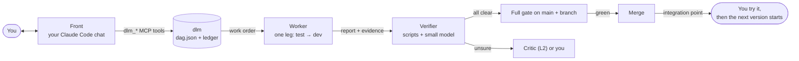

# dev-loop-mcp

**English** | [繁體中文](README-zh.md)

**An MCP server that takes AI from a requirement all the way to merged code.**
You talk to one chat window. In the background, dlm plans the work as a DAG, sends headless agents to build it one small step at a time, checks every claim by re-running it, and merges only what passes. It asks you only about things that really need a human.


v4.10.0 · Node ≥ 20 · zero dependencies · 206 automated tests · worker CLIs: Claude Code (tested for real), Codex (not yet tested for real)

> Formerly **dev-paradigm**, then **dev-paradigm-mcp** (command `dp`). Since 4.8.0 it is called **dev-loop-mcp**, and the command is `dlm`. MCP tools start with `dlm_`. Coming from `dp`? See [Upgrading from dp](#upgrading-from-dp-473-and-earlier).
>
> Most docs inside the repo (`docs/`, `payload/docs/dlm/`) and the CLI's own messages are in Traditional Chinese.

## Contents

- [What it feels like](#what-it-feels-like)
- [How it works](#how-it-works)
- [Install and deploy](#install-and-deploy)
- [Upgrading from dp (4.7.3 and earlier)](#upgrading-from-dp-473-and-earlier)
- [Quick start](#quick-start)
- [Features](#features)
- [Dashboard tour](#dashboard-tour)
- [Reference](#reference)
- [Status: what has been tested](#status-what-has-been-tested)
- [This repo](#this-repo)

## What it feels like

Below is a shortened version of a real session from the test run behind this README (2026-10-16). Claude Code was started outside any project and given **only** the dlm MCP tools. (The run used 4.7.3, when the command was still `dp`; names are shown as they are since 4.8.0.)

```
You:     Use dlm to start a new project in /data/python/dp-demo/todo-cli. A todo CLI in Node.
         v1 is just `todo add <text>` and `todo list`; `todo done <n>` comes later.
         Run worker, Critic and Verifier on my Claude subscription account; Verifier on haiku.
         Autonomy L1, $5 a day.
Claude:  dlm_flow → dlm_list_accounts → dlm_init_project → dlm_setup_project → dlm_set_role ×3 → dlm_propose_bundle
         "Plan for v1 (proposal p-001): todo/v1 (add + list), shared/bin (the `todo` command),
          I1 (you try it yourself). The roadmap already has v2 = todo done. Say OK to start."
You:     OK, approved, go.
Claude:  dlm_decide node:p-001 yes (your exact words) → dlm_start_loop
         "2 workers are running on your account: todo/v1 is writing tests first, shared/bin is editing package.json."
You:     Progress?
Claude:  dlm_get_project → dlm_get_inbox → dlm_show
         "shared/bin is done and waiting for you. The Verifier wasn't sure about one item: it wanted to
          re-run `npm pkg get bin`, but that command isn't on its allowed list. It didn't find a problem.
          Merge it?"
You:     Merge.
```

## How it works



| Role | What it is | Can approve |
|---|---|---|
| **Front** | The chat you talk to (Claude Code, Cursor, Codex…). It changes state only through dlm tools. | Nothing. It passes on your words. |
| **Orchestrator** | `dlm tick`, a plain script. The only writer of the ledger. Dispatches, verifies, merges. | Nothing. It just runs the rules. |
| **Worker** | A headless model run (`claude -p`), one per leg, in a copy of the repo without `.git`. | Nothing |
| **Verifier** | Deterministic script checks plus very narrow questions to a small model (Claude Haiku by default). Never reads the worker's story. | It can only say no (FAIL) or "not sure" (ABSTAIN) |
| **Critic** | An optional large model. Reads the spec, the checks and the diff. | At L2: hand-ins the Verifier was unsure about |
| **You** | — | Everything. Some things are always yours (see [Autonomy levels](#5-autonomy-levels)). |

The core ideas:

- **Each fact lives in one place, and only the script writes it.** The structure is in `dag.json`. History is in the append-only `ledger/events.jsonl`. State comes from replaying the ledger. Two files can never disagree.
- **"Done" must be re-runnable.** Every claim a worker makes comes with a command and an exit code. dlm re-runs the same command. The test leg must be red, the dev leg must be green, and writing outside the allowed files gets the leg sent back.
- **An agent gets only what its leg needs.** No whole DAG, no huge rule file. Every prompt that goes out is saved, so you can see exactly what the worker saw.
- **Small models review big models, but can only say no.** A small model's mistake costs you one extra question. It can never let bad code into main.
- **Grow one version at a time.** Each version ends with an integration point. You try it with your own hands. The next version starts only after you say it works.
- **Loose permissions, strict records.** Front can read, write and run commands. dlm blocks only what would corrupt state or can't be undone.

## Install and deploy

You need Node ≥ 20, git, and an MCP client (Claude Code is the tested one). Workers also need a model CLI: Claude Code (tested for real) or Codex (written from its docs, not yet tested for real).

```bash
git clone https://github.com/pollux0971/dev-loop-mcp.git
node dev-loop-mcp/tools/dlm.mjs mcp install
```

`dlm mcp install` registers one MCP server named `dlm` for the whole machine. It manages every dlm project on it.

| Client | Command | What it does |
|---|---|---|
| Claude Code (default) | `dlm mcp install` | `claude mcp add --scope user dlm -- node <absolute path>/tools/dlm.mjs mcp` |
| Cursor | `dlm mcp install --client cursor` | writes `~/.cursor/mcp.json` |
| Codex | `dlm mcp install --client codex` | `codex mcp add` |
| One project only | `dlm mcp install --client project` | writes that project's `.mcp.json` |
| Anything else | `dlm mcp config` | prints the config so you can paste it yourself |

Check it worked:

```bash
claude mcp list        # → dlm: node …/tools/dlm.mjs mcp - ✔ Connected
```

Then restart Claude Code. `/mcp` shows `dlm` with 38 tools and 4 prompts.

- **Install from the dev-loop-mcp folder.** The copy of dlm inside each project has no `payload/`, so it can't create projects.
- **Updating:** `git pull`, then run `dlm mcp install` again. Upgrade each project with `dlm upgrade` inside it, or the `dlm_upgrade_project` tool.
- **Removing:** `claude mcp remove dlm -s user`. Your projects and their ledgers stay untouched.

## Upgrading from dp (4.7.3 and earlier)

4.8.0 renames the project from dev-paradigm-mcp to dev-loop-mcp, and the short name and command from `dp` to `dlm`. Your data carries over:

1. **Reinstall the MCP.** In the dev-loop-mcp folder (`git pull`, or clone the new URL), run `node tools/dlm.mjs mcp install`. It registers `dlm` and removes the old `dp` registration if it points at a `tools/dp.mjs`. Restart Claude Code. Tools are now `dlm_*` and prompts are `/mcp__dlm__...`.
2. **Machine config moves by itself.** The first time the new version runs, `~/.config/dp` becomes `~/.config/dlm`, and absolute paths inside `accounts.json` are rewritten. Env vars are now `DLM_*` (`DLM_CONFIG_DIR`, `DLM_ACCOUNTS_FILE`, `DLM_PROJECTS_FILE`, `DLM_KEY_FILE`).
3. **Upgrade each project.** Stop its background loop first. Then use the `dlm_upgrade_project` tool, or run `node <dev-loop-mcp>/tools/dlm.mjs upgrade` inside the project. It renames `dp.config.json`, `.dp/`, `docs/dp/`, `docs/dp-baseline.json`, `.dp-install.json` and `tools/dp.mjs` to their `dlm` names, repairs the git worktrees, patches `package.json`, `.claude/settings.json`, `.gitignore`, `.mcp.json` and `cucumber.js`, and makes one commit. In AGENTS.md and the template READMEs it changes only the forms dp wrote (`` `dp` ``, `dp status`, `dp_*` tools), so your own text that says "dp" stays. `tools/dp.mjs` becomes a tiny file that forwards to `tools/dlm.mjs`, because Claude Code sessions started before the upgrade keep calling the old hook path; restart Claude Code, then you can delete it. If you edited `tools/dp.mjs` or `docs/dp/`, or a tick or worker is still running, it writes nothing. `--dry-run` lists every step.

Until a project is upgraded, the new MCP still works with it, because it runs that project's own `tools/dp.mjs`. Ledger history is not rewritten: old events with actor `dp-cli`, old `dp-archive/*` tags and old `dp/*` branches stay valid. See [MIGRATION.md](MIGRATION.md).

## Quick start

### A. Through MCP (recommended)

Open Claude Code in any folder and just say what you want:

> Use dlm to start a new project in ~/code/my-app. I want a budgeting CLI.

Or type `/mcp__dlm__new-project`. The AI follows dlm's built-in flow:

1. `dlm_init_project`, then `dlm_setup_project`. It asks you about autonomy level and budget first.
2. It talks through the first version with you, then calls `dlm_propose_bundle`. This is only a proposal; nothing is built yet.
3. When you say OK, it calls `dlm_decide` with your exact words, then `dlm_start_loop`.
4. "How's my project doing?" runs `dlm_overview` + `dlm_get_inbox`. It relays what needs you.
5. When a version is ready, it tells you how to try it. Your answer goes in with `dlm_confirm`.

The whole flow, step by step: `dlm_flow`, or [`payload/docs/dlm/FLOW.md`](payload/docs/dlm/FLOW.md).

### B. Through the CLI

```bash
node dev-loop-mcp/tools/dlm.mjs init my-app --name my-app   # also registers it on this machine
cd my-app
node tools/dlm.mjs setup      # one question at a time: which AI, Verifier, autonomy, budget
node tools/dlm.mjs doctor     # health check: ✓ / ⚠ / ✗ for each item, with a fix for each problem
```

Then open Claude Code in `my-app` and type `/inbox`. From now on, talk only to that window. Front asks whether to start the background loop (`dlm run --daemon`; stop it with `dlm run --stop`). After that, dlm moves things forward every 60 seconds.

### C. An existing project (brownfield)

```bash
node dev-loop-mcp/tools/dlm.mjs init . --existing   # adds only dlm's files
node tools/dlm.mjs setup                                 # pick Brownfield, confirm the test command
node tools/dlm.mjs onboard                               # test baseline + docs/AS-IS.md draft + ROADMAP v0
```

Or through MCP: `/mcp__dlm__existing-project`. See [Existing projects](#7-existing-projects-brownfield) below.

## Features

### 1. One window (Front)

You talk to one chat. Front is whatever AI client you use: Claude Code with dlm's skills when you work inside a project, or any MCP client through the dlm tools.

- **Inside a project**, Claude Code gets slash commands (`/inbox`, `/status`, `/decide`, `/intake`) and skills (`front`, `intake`, `brownfield-onboard`, `decision-record`, `mutation-testing`; v4.9 adds `explain`, `why`, `catchup`, `sharpen`, `interrogate`, and `blast-radius`, adapted from pstack).
- **From anywhere**, the MCP server hands the client dlm's flow and rules when it connects, so even a fresh session knows what to do.
- **The inbox has three parts:** what needs your decision (with options and a recommendation), what happened since you last looked (merges, send-backs, cost), and where to dig in for details.
- **Decisions are yours.** `decide`, `confirm`, `unblock` and `resume` only pass on what you said in this turn, word for word. Front never picks for you. Text written by workers or models is always marked `untrusted` and treated as data, never as instructions.

### 2. Plan one version at a time

New work always goes in as a **proposal** first. dlm writes it into the DAG only after you approve it.

- **A bundle is a whole version:** a few capability nodes plus one **integration point** (`I1`, `I2`…). Its gherkin has `@e2e` scenarios you will try by hand. One proposal, one approval.
- **The roadmap** (`docs/ROADMAP.md`) holds the later versions. Only the current version goes into the DAG.
- **Versions wait for each other.** The next version's nodes depend on the previous integration point. They start only after it is merged **and** you have confirmed it works.
- **Node kinds:** `phase` (one version of one capability, e.g. `todo/v1`), `integration` (`I1`), `shared` (shared things like `package.json`; only a shared node may touch build and gate files).
- **The tool schema lists every field.** `dlm_propose_feature` and `dlm_propose_bundle` describe each field (types taken from the DAG's own schema). Mistakes are rejected right away, with the exact field named, e.g. `body.bundle.nodes[0].intent: 長度 > 300` (length > 300).
- **Proposals warn about traps.** The proposal still goes through, but comes back with `warnings` (also shown in the inbox) when: a new project's node puts code outside `packages/` and `apps/` (the template's tests and mutation testing only look there), or an integration point's gherkin reuses a capability's sentences word for word (it would already be green, so its test leg could never start red).
- **Side branches.** If a worker finds a small feature that must exist first, it can propose a child node (`v1.1`). At L2, a child that stays inside its parent's scope is approved automatically; otherwise you are asked.

### 3. Relay legs and machine checks

Each node is built as a short relay. A **leg** is one headless run with one job:

| Leg | Job | Must end |
|---|---|---|
| `characterize` | Brownfield only: write tests that pin down how the existing code behaves now | green on the current code |
| `test` | Write tests from the gherkin. No implementation. | **red** (for the right reason, not a syntax error) |
| `dev` | Make the tests pass. May not touch tests or gherkin. | green |
| `integrate` | Wire capabilities together at the integration point | green |
| `test-fix` | Fix a test the dev leg proved wrong (after the Critic or you agree) | — |

Default pipelines: `phase` = test → dev, `integration` = test → integrate, `shared` = dev.

After each leg, the Verifier runs **script checks** first: clean worktree, no sandbox escape (touching `.git`, `.dlm/`, `node_modules`, symlinks), only allowed paths written, a real report, every piece of evidence re-run with the same exit code, acceptance red or green as required. Optional checks: gherkin dry-run (every step bound) and incremental mutation testing.

Before merging, dlm builds a temporary tree of **main + the branch** and runs the full gate (`check:dlm`, `typecheck`, `test`, `accept` by default). If main moves while you are deciding, it re-runs on the new main first.

When something is wrong, the work goes back to **the leg that caused it**. A wrong test goes back to the test leg instead of the dev leg retrying until it's stuck. After 3 failed attempts a node is blocked and you are asked.

Sometimes an integration point is already done before it starts, because the capabilities already wired everything up. Then its test leg can't honestly start red. Before sending that test leg, dlm runs the acceptance itself; if it already passes, dlm doesn't send a worker, records why, and moves on to the integrate leg (`integration.precheck_green`, on by default). If a test leg still gets stuck that way later (for example, a redo after a failed trial), dlm re-runs the acceptance and offers one extra choice, **skip**. An integrate leg with nothing to change is fine, as long as the acceptance passes.

### 4. Small model reviews big model

Anything a script can judge, a script judges. What's left goes to a small model as a very narrow question:

- **claim-supported:** does dlm's own re-run output contradict this claim?
- **scenario-honesty:** does this implementation special-case the exact values in the gherkin (hard-coding the test)?

Each question is asked **two different ways**. If the answers disagree, the result is ABSTAIN. Failures, timeouts, bad JSON or oversized input are also ABSTAIN, never "fine". The only possible answers are FAIL, ABSTAIN and NO_OBJECTION. There is no PASS.

At L2, ABSTAIN goes to the **Critic**, a large model that reads the spec, the checks and the diff, but not the worker's story. If the Critic isn't sure either, it comes to you.

### 5. Autonomy levels

`autonomy.level` in `dlm.config.json`:

| Level | Merge | Verifier not sure | Side child nodes |
|---|---|---|---|
| L0 | asks you every time | asks you | asks you |
| **L1** (default) | automatic when every check passes | asks you | asks you |
| L2 | same as L1 | goes to the Critic; asks you if the Critic isn't sure | automatic inside the parent's scope |

**Always yours, at every level:** new features and versions (every proposal), major contract changes, the rules layer, budget and autonomy level, `@e2e` trials, and resuming after a halt.

To change the level, the daily budget or the number of workers, say so to Front. It calls `dlm_set_settings` with your exact words (CLI: `dlm settings --autonomy 2 --budget 8 --parallel 3 --verbatim "…"`). Only the fields you name change, and the change is committed with your words in the commit message. Nodes marked `tier: strict` and `shared` nodes without an `accept` command always get a second opinion. Without a Verifier model, the last leg of a node with gherkin never auto-merges.

### 6. Ledger, signatures and safety

- **Signed ledger.** Every event carries `prev_hash` (sha256 of the previous line) and `mac` (an HMAC with a key outside the repo, `~/.config/dlm/key`). If anyone edits or appends by hand, `dlm check ledger` reports it and `dlm tick` refuses to run.
- **Your words are signed.** Inside a project, a Claude Code hook signs every message you send. When a decision's verbatim text matches something you really said, the event records its hash. Later you can tell which decisions you made yourself.
- **Workers never see `.git`.** They work in an exported copy. Only changes inside the allowed paths are copied back, and dlm commits them itself.
- **Evidence re-runs are locked down.** Only commands starting with an allowed prefix (`npm run`, `npm test`, `node --test`, `npx vitest`, `git diff`…), run as argv without a shell. No `cat`, no absolute paths, no `..`.
- **Gate files are off-limits.** `package.json`, lockfiles, `tsconfig.json`, test configs, `scripts/**`, `.github/**` and dlm's own files are forbidden to workers. Changing them needs a `shared` node that you approve.
- **This is not OS-level isolation.** Code runs as you, on your machine. The Claude worker command blocks `rm -rf`, `rm -fr` and `sudo`, but keep backups. For stronger isolation, run the whole project in a container or VM. See [`payload/docs/dlm/SECURITY.md`](payload/docs/dlm/SECURITY.md).

### 7. Existing projects (brownfield)

- **The gate runs the project's own tests.** `setup` detects `npm test`, pytest / unittest, `go test`, `cargo test` or `make test` and writes it to `gates.commands` (e.g. `{"test": "python3 -m unittest"}`). Non-Node projects don't get the template's TypeScript toolchain.
- **Tests that were already red aren't the worker's fault.** `dlm onboard` (re-record with `dlm baseline`) runs the tests on main and records the failures in `docs/dlm-baseline.json`. A red gate passes if every red test is in the baseline. One new red test blocks the merge, and dlm names it.
- **Pin down current behavior before changing it.** When a node's `owns` covers files that already exist on main, the proposal adds a `characterize` leg in front: it may only write tests, and those tests must pass on the current code. Later legs can't change them, and the dev leg must keep them green. At most 10 files at a time. Behavior you mean to change goes in the gherkin instead.
- **`docs/AS-IS.md`** describes the project as it is today. `onboard` writes a draft, and Front completes it by reading the code.
- **dlm's own files go into git.** In a project that already has git, `dlm init --existing` commits the files it adds (only those paths; anything you staged stays staged) and adds `.dlm/` to your `.gitignore`. The pre-merge gate runs in a tree built from git, so dlm must be in git to run there. `dlm doctor` fails if it isn't, and `dlm upgrade` fixes it.


<sub>Screenshot from 4.7.3, before the rename: the logo and the labels in it still say dp.</sub>

### 8. Subscription accounts

If you have several Claude Max / Pro or ChatGPT (Codex) plans, dlm can rotate through them and switch when one hits its limit.

```bash
node tools/dlm.mjs account add max-a --cli claude --plan max        # each account gets its own login folder
node tools/dlm.mjs account add work --cli claude --home ~/.claude   # or point at a login you already have
node tools/dlm.mjs account login max-a                              # opens a browser once
node tools/dlm.mjs account use worker max-a,work --model sonnet     # worker rotates between them
node tools/dlm.mjs account use verifier max-a                       # Verifier defaults to haiku
node tools/dlm.mjs account list                                     # login, usage, cooldowns
```

- Claude Code is pointed at the account with `CLAUDE_CONFIG_DIR`, Codex with `CODEX_HOME`. While dispatching, dlm clears `ANTHROPIC_API_KEY` and similar variables, so an API key in your shell can't take over.
- Each leg picks the account with the fewest dispatches in the last 5 hours that isn't cooling down. When a log says the limit was hit, that account cools down until its reset time, and the leg goes to the next account right away. That doesn't count as a failed attempt.
- Usage, cooldowns and `--max-parallel N` are shared across all projects on the machine. The account list lives in `~/.config/dlm/accounts.json`, never in the repo.
- You can also do all of this from the dashboard's **Accounts** page, or through MCP (`dlm_add_account`, `dlm_set_role`). Logging in always happens in your own terminal, because it opens a browser.

### 9. Many projects, one hub

```bash
node tools/dlm.mjs hub           # http://127.0.0.1:7170/
node tools/dlm.mjs project list  # projects registered on this machine
node tools/dlm.mjs hub token     # API token
```

The hub shows one card per project: progress, which worker is on which node and leg with which account, how many things are waiting for you, today's spend, and buttons to start or stop the loop and halt or resume. Projects that need you come first. On the right: account usage and cooldowns, and a live event feed from every project (SSE). It can send a browser notification when something new needs you. Click a project to open its dashboard.

Several projects each running their own loop is parallel development across projects. Inside each project, up to `caps.parallel` workers (default 3) build at once.

### 10. One route table, three ways in

`tools/lib/api.mjs` defines **41 operations**. All three entry points are generated from it, with the same parameters and results:

- **HTTP API** from `dlm hub`: `/api/v1/...`, with the OpenAPI 3.1 spec at `/api/v1/openapi.json`. Needs `Authorization: Bearer <token>` except for health and openapi. Binds only to 127.0.0.1 and checks Host and Origin.
- **MCP tools:** `dlm_` + the operation id in snake_case, e.g. `dlm_get_inbox`. That's 38 tools; streaming and openapi are HTTP-only.
- **CLI:** `dlm op <operation> --args '{json}'`.

For project operations, the hub and MCP run **that project's own copy** of dlm. A project on an older dlm version can't be misread; anything older than 4.7 returns 501 and points you to `dlm_upgrade_project`. The MCP server refuses to start inside a worker or Critic environment, so a worker can never approve its own work.

Docs: [`payload/docs/dlm/API.md`](payload/docs/dlm/API.md) (every endpoint and parameter) and [`FLOW.md`](payload/docs/dlm/FLOW.md). Both are generated by `dlm api`, and a test checks they're current.

### 11. Background loop, halt and budget

- **`dlm run --daemon`** (MCP: `dlm_start_loop`) runs a tick every 60 seconds: collect hand-ins → verify → merge → dispatch. `dlm run --stop` (`dlm_stop_loop`) lets the current tick finish first, so it never stops halfway through a merge.
- **`dlm halt`** stops dispatching and ends running workers (that doesn't count as a failure). Only you can `resume`.
- **Budget:** `budget.daily_usd` (default $5; change it with `dlm settings --budget` or `dlm_set_settings`). Workers and the Critic report their cost; dlm stops dispatching when today's total reaches the limit. On a subscription, these numbers are what the CLI reports, not what you're billed.
- **Infrastructure failures** (429, 5xx, timeouts) don't count as worker attempts. dlm backs off and retries, and halts after too many in a row.
- **Notifications:** `notify.cmd` runs a command of yours when something new needs you.

### 12. Health checks and upgrades

- `dlm doctor` (`dlm_doctor`): Node, config, git, whether dlm's own files are in git, worker command, Verifier, every account's login, hooks, merge gate. Each item gets ✓ / ⚠ / ✗ and a fix.
- `dlm check`: DAG, ledger chain, generated files, contracts, placeholders, rule size and conflicts.
- `dlm upgrade` (`dlm_upgrade_project`): updates dlm's files in a project and commits them (plus any of dlm's files that were never committed). If any file conflicts, it writes none. `--dry-run` shows what would change.
- Old settings from earlier versions still load. `doctor` lists each one that was removed.

## Dashboard tour

```bash
node tools/dlm.mjs dashboard --serve   # one project: http://127.0.0.1:7171/, re-reads the ledger every 5 s
node tools/dlm.mjs dashboard           # no server: writes .dlm/dashboard.html, one file with the data inside
node tools/dlm.mjs hub                 # all projects; click one to open its dashboard
```

The dashboard is read-only, with one exception: the Accounts page. It is built from the same ledger replay as `dlm status`. It never writes events and binds only to 127.0.0.1. Decisions still go through Front or `dlm decide`. The bar at the bottom always shows what's waiting for you and the exact command to answer it.

**Which page it opens on:** when nothing is being built (no worker running, nothing being checked, blocked or ready to dispatch, no merge waiting), it opens on **Planning**, because the next step is planning the next version with Front. Otherwise it opens on the **Console**.

### Console


Four columns for the selected node:

- **Orchestrator:** dispatches, send-backs and merges, plus this leg's work order: objective, write-set, forbidden paths, acceptance command, done-when.
- **Worker:** one tab per leg. Each hand-in shows the worker's claims with the evidence commands and their output, plus the node's to-do list.
- **Verifier · Critic:** every machine check and small-model answer (NO_OBJECTION / ABSTAIN / FAIL), and the Critic's verdict.
- **Harness:** worktree, launch, commit, gate, merge, cost.

At the top: role status lights, the cost bar, and **▶ Replay**, which plays one node's events back one by one.

### Planning


Left: the planning record with Front. You see each proposal's nodes, write-sets, gherkin files and options, and your exact words when you approved or tried something. Right: version progress from `docs/ROADMAP.md`. The top-right shows Greenfield / Brownfield. For brownfield projects it also shows the test baseline and whether AS-IS is written.


<sub>Screenshot from 4.7.3, before the rename: the logo and the labels in it still say dp.</sub>

### Pipeline


Versions across the top, then a kanban board: not started, building, being checked, blocked, done. Each card shows the node's kind, dispatch count and cost. Click a card to open it in the console.

### Timeline


The append-only ledger, replayed as-is. Filter by node. Rows with ▸ expand to show send-back reasons, Critic notes, verification results and gate results.

### Cost


Total, today, daily limit, nodes done, cost per node. Below: cost by role and by node, and a table of subscription accounts with dispatches in the last 5 hours / 7 days and cooldown status.

### Accounts


Add or remove accounts on this machine, and tick which accounts each role (Worker, Critic, Verifier) rotates through, with an optional model. Each action runs `dlm account …`, exactly like typing it in the terminal (the config change is committed). It only works with `--serve` or inside the hub, and only with a token created for that launch. (In every screenshot here, the account name, plan and login email are anonymized.)

## Reference

### MCP tools (38)

| Group | Tools |
|---|---|
| Flow and monitoring | `dlm_flow`, `dlm_health`, `dlm_overview`, `dlm_get_project`, `dlm_get_inbox`, `dlm_mark_inbox_seen`, `dlm_show`, `dlm_list_events`, `dlm_list_nodes`, `dlm_list_proposals`, `dlm_get_dashboard`, `dlm_get_loop`, `dlm_doctor` |
| Projects and settings | `dlm_list_projects`, `dlm_add_project`, `dlm_init_project`, `dlm_setup_project`, `dlm_set_settings`, `dlm_onboard`, `dlm_baseline`, `dlm_upgrade_project`, `dlm_remove_project` |
| Proposals and your decisions | `dlm_propose_bundle`, `dlm_propose_feature`, `dlm_decide`, `dlm_confirm`, `dlm_unblock` |
| Background loop | `dlm_start_loop`, `dlm_stop_loop`, `dlm_tick`, `dlm_halt`, `dlm_resume` |
| Accounts and roles | `dlm_list_accounts`, `dlm_add_account`, `dlm_update_account`, `dlm_remove_account`, `dlm_get_roles`, `dlm_set_role` |

**Prompts** (in Claude Code: `/mcp__dlm__<name>`): `new-project`, `existing-project`, `progress`, `next-release`.

### CLI

| Area | Commands |
|---|---|
| Install and setup | `dlm init <dir> [--existing] [--no-commit]`, `dlm setup`, `dlm settings [--autonomy N] [--budget X] [--parallel N]`, `dlm doctor`, `dlm upgrade [--dry-run]` |
| Existing projects | `dlm onboard`, `dlm baseline` |
| Background loop | `dlm tick`, `dlm run [--interval 60] [--daemon] [--until-idle]`, `dlm run --stop` |
| One window | `dlm inbox`, `dlm show <ref>`, `dlm decide <ref> <choice> --verbatim "…"`, `dlm confirm <node> yes\|no`, `dlm halt`, `dlm resume`, `dlm unblock <node>`, `dlm status`, `dlm dashboard [--serve]` |
| Proposals | `dlm intake feature --spec spec.json`, `dlm intake bundle --spec bundle.json`, `dlm intake apply <id>` |
| Accounts | `dlm account add\|set\|login\|list\|use\|rm` |
| MCP | `dlm mcp install [--client …]`, `dlm mcp config`, `dlm mcp tools`, `dlm mcp` |
| Many projects | `dlm project add\|list\|rm`, `dlm hub`, `dlm hub token`, `dlm op <operation>`, `dlm api [md\|openapi\|flow]` |
| Checks | `dlm check`, `dlm gates`, `dlm render`, `dlm stats` |

Add `--help` to any command to print its help without running it.

### Settings (`dlm.config.json`)

| Key | Default | Meaning |
|---|---|---|
| `autonomy.level` | `1` | L0 / L1 / L2 (see above) |
| `budget.daily_usd` | `5` | Stop dispatching after this much today |
| `caps.parallel` | `3` | Workers at once in this project |
| `caps.attempts` | `3` | Tries per leg before the node is blocked |
| `caps.lease_minutes` | `90` | How long a worker may run |
| `gates.chain` | `check:dlm, typecheck, test, accept` | Full gate before every merge |
| `gates.commands` | `{}` | Commands for gate names that aren't npm scripts (brownfield) |
| `agents.worker` / `critic` / `verifier` | — | `cmd`, or `accounts` + `model` |
| `integration.gate_next_version` | `true` | Next version waits for your trial of the last one |
| `verify.rerun_allow` | `npm run`, `npm test`, `node --test`, … | Command prefixes dlm may re-run as evidence |
| `notify.cmd` | `null` | Run this when something new needs you |

More: [`payload/docs/dlm/AGENTS-SETUP.md`](payload/docs/dlm/AGENTS-SETUP.md), [`payload/AUTONOMY.md`](payload/AUTONOMY.md), [`payload/docs/dlm/VERIFIER.md`](payload/docs/dlm/VERIFIER.md).

## Status: what has been tested

### Automated tests

`npm test`: **205 tests, all passing.** They use fake workers, agents and small models (`test/fixtures/`) inside real git repos. They cover the full flow (create → propose → approve → red test leg → green dev leg → full gate in a temp tree → merge → integration point → your confirmation), failure paths (out-of-scope writes, lying evidence, missing reports, three-strikes block, crash re-runs, halt, budget, Critic verdicts, tampered ledger), install and upgrade, the small-model layer, accounts, the hub API and SSE, and the MCP server over stdio.

### Real run, 2026-10-16

Both real runs below used 4.7.3, when the command was still `dp`. Commands and tool names are shown with their 4.8.0 names (`dlm`, `dlm_*`); the 4.8.0 upgrade itself was then tested on the minilang project from the second run.

Setup: Claude Code 2.1.301 on Linux, Node 22.15.1. `dlm mcp install` registered `dlm` in Claude Code's user scope (`claude mcp list` → ✔ Connected). Worker, Critic and Verifier all ran on one Claude subscription, registered as a dlm account that points at the existing login (`dlm account add <name> --cli claude --home <login folder>`). I played the user with short messages. Front was a fresh `claude -p` session, resumed turn by turn, with **only** the dlm MCP tools (for the existing project it also had read-only Read / Glob / Grep). Autonomy L1. Every screenshot in this README comes from this run.

| | todo-cli (new project) | wordfreq (existing Python project) |
|---|---|---|
| Asked for | `todo add` / `todo list`, later `todo done` | add `--top N` to `wordfreq.py` (tests: unittest) |
| Versions | v1 and v2, both tried by hand and confirmed | v1, tried by hand and confirmed |
| Nodes | 6 (2 capabilities, 2 integration points, 2 shared) | 2 (`top/v1`: characterize → test → dev, and `I1`) |
| Worker runs | 13 (2 sent back) | 10 (4 sent back) |
| Times dlm asked me | 13 (3 plans, 7 merges, 3 stuck legs) + 2 trials | 7 (1 plan, 3 merges, 3 stuck legs) + 1 trial |
| Wall time | 75 min | 60 min |
| Reported cost | $9.76 | $7.63 |

What went well:

- Front never decided for me. Every `dlm_decide` and `dlm_confirm` carried my exact words. It relayed "not sure" items honestly, sometimes read the code itself to double-check, and warned me before the budget ran out.
- "It works, stop the loop" in one sentence: it recorded the trial **and** stopped the loop.
- Workers refused to fake results. In both projects the integration point's test leg could not start red, and the worker escalated instead of writing a test that fails on purpose.
- Once the new warnings existed, they changed the v2 plan: Front set `I2` to integrate-only and proposed a small shared node so `npm test` runs the worker's unit tests (47 now run).

Found and fixed during the run (4.7.3, details in [CHANGELOG.md](CHANGELOG.md)):

1. `dlm_health` always failed through MCP.
2. The proposal tools' `spec` / `bundle` had no fields (also reported and fixed in PR #1).
3. `owns` was required by the DAG but not by the tool schema.
4. A Verifier model set for an account was silently dropped.
5. New-project code outside `packages/` / `apps/` meant zero unit tests in the gate → proposal warning.
6. No way to change budget or autonomy through MCP → `dlm_set_settings` / `dlm settings`.
7. Re-running setup replaced an account-based worker with a fixed command.
8. An integration point that was already green before it started got stuck forever → `skip` option, and integrate legs may have zero changes.
9. Integration gherkin reusing a capability's sentences → proposal warning.
10. Installing into a project that already had git left dlm's files uncommitted, so every pre-merge gate failed → init and upgrade commit them, doctor checks.
11. `dlm upgrade` left its changes uncommitted, so ticks refused to run → upgrade commits.

Still rough:

- At L1, dlm still asks often. Most "not sure" items were the small model's two phrasings disagreeing, a diff with only a README in it, or mutation testing that couldn't run.
- An MCP-only Front can't edit files, so it can't complete `docs/AS-IS.md` for an existing project.
- While waiting, Front polls `dlm_list_events` in a loop; there's no long-poll.

### Second real run: a small language interpreter (Sonnet 5.5)

`minilang`, a TypeScript interpreter with a lexer, parser, evaluator and CLI, built in three versions: v1 math with operator precedence and column-accurate errors, v2 variables and program files, v3 functions, recursion, comparisons and `if`. Front and workers both ran on Sonnet 5.5; Verifier on Haiku; autonomy L1.

| | minilang |
|---|---|
| Nodes | 9 (`expr` v1–v4, `interp` v1–v2, `I1`–`I3`) |
| Worker runs | 37 (5 sent back) |
| Times dlm asked me | 20 (5 plans, 6 merges, 4 "test is wrong", 5 stuck legs) + 5 trials (2 failed) |
| Wall time / reported cost | 115 min / $6.34 |
| Result | 107 unit tests and 142 acceptance steps pass; every hand trial matched the spec |

Highlights: the `test-fix` leg ran for real for the first time, three times. Workers caught a test that contradicted the spec (`-2 ^ 2` must be `-4`) and an off-by-one in a recursion-depth test. When I reported a "bug" that was really my own mistake, the worker could not reproduce it and refused to "fix" it. A hand trial found a real bug in an already-merged module (recursion broke at ~700 levels, not 1000); Front proposed a fix node that `I3` waits for.

Found and fixed during this run: a superseded proposal stayed approvable (→ `supersedes`), mutation testing asked the user on every CLI integration (→ SKIPPED for integrate legs), the small model was asked about claims dlm had already verified (→ SKIPPED), the template had no safe way to run a CLI from a temp folder (→ `runCommand({ cwd })`), integration points that were already green wasted a worker run (→ checked before dispatch), proposals ignored `parent`/`relation` (→ wired), and integration `test-fix` legs had to end red (→ no longer). Details in [CHANGELOG.md](CHANGELOG.md).

### Not verified yet

- **Codex** as a worker, Critic or Verifier: the default commands were written from its docs and never run for real.
- **Rotating between two or more real subscriptions** until one hits its limit: only automated tests (a fake worker prints `usage limit reached|<time>`).
- **`dlm mcp install` for Cursor and Codex**: only the Claude Code path was run for real.
- **`max_parallel` at full load** with real workers.
- Gemini CLI and OpenCode have no account support. To use them, write `agents.<role>.cmd` yourself.

## This repo

```
tools/      the dlm CLI and MCP server (zero dependencies); copied into each project
payload/    files `dlm init` writes into a project: rules, prompts, skills, docs/dlm, templates
test/       automated tests
docs/       ARCHITECTURE.md (design and reasons), adr/, images/ (README screenshots)
```

Doc map: design → [docs/ARCHITECTURE.md](docs/ARCHITECTURE.md) · upgrading → [MIGRATION.md](MIGRATION.md) · changes → [CHANGELOG.md](CHANGELOG.md) · user flow → [WORKFLOW.md](payload/docs/dlm/WORKFLOW.md) · roles → [ROLES.md](payload/docs/dlm/ROLES.md) · small-model checks → [VERIFIER.md](payload/docs/dlm/VERIFIER.md) · security → [SECURITY.md](payload/docs/dlm/SECURITY.md) · API → [API.md](payload/docs/dlm/API.md)
