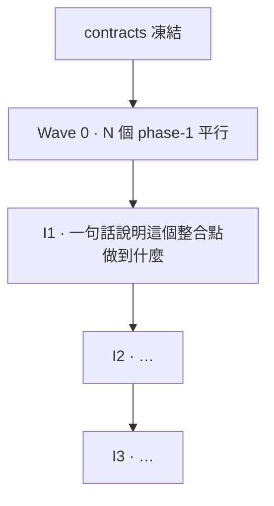

# Roadmap

一個 Wave + {{INTEGRATION_COUNT}} 個 Integration。Wave 0 內部完全平行,I1–I{{INTEGRATION_COUNT}} 嚴格依序。
每個 integration 通過時,系統都是完整可用的。

策略說明見 `05-parallel-and-integration.md`。

## 現況

| 欄位 | 值 |
|---|---|
| 目前階段 | Wave 0 |
| 目前 sprint | (無 / 指向 `docs/sprints/` 的檔案) |
| 契約版本 | {{CONTRACT_VERSION}}(凍結 / 未凍結) |
| 最後更新 | {{TODAY}} |

## 全貌

依你實際的整合點數量增減節點。**每個節點的標籤必須是「使用者做得到什麼」**,
不是技術層次(不要寫「I1 後端完成」,要寫「I1 之後可以做 X」)。

---

## Wave 0 · {{WAVE0_COUNT}} 個 phase-1,完全平行

**前提**:`contracts/types.md` 已凍結、`contracts/fixtures/` 已建立。

**規則**:這些 phase 之間**沒有任何依賴**。可以全部同時開,也可以一次一個。
每個都只 import `contracts/`,跨資料夾 import 是違規(`npm run boundaries` 會檢查)。

| Phase | 交付 | 單獨執行 | Gherkin |
|---|---|---|---|
| {{FEATURE_01}}/phase-1 | | | [phase-1](../features/{{FEATURE_01}}/phase-1.feature) |
| {{FEATURE_02}}/phase-1 | | | [phase-1](../features/{{FEATURE_02}}/phase-1.feature) |
| ... | | | |

**Wave 0 完成定義**:全部 phase 都 `done`,且 `standalone.json` 裡的非互動指令都能跑。

如果某個能力是「組合層」——把其他模組串起來的薄薄一層——它通常**不參與 Wave 0**:
組合層在被組合的東西存在之前無法獨立,硬造一個吃 stub 的版本等於寫兩次。
這種例外要在該資料夾的 `FEATURE.md` 說明理由,並記一筆 ADR(範式本身的先例見
`02-decision-map.md` 標「來源:範式」的組合層那條)。

**順序完全自由。** 建議把「產出契約可執行版本」的那個能力(例如把 `contracts/types.md`
變成 zod schema 的資料層)排最前——其他人整合時要用它。

---

## I1 · (一句話:這個整合點之後,使用者做得到什麼)

**你做得到什麼**:(一句使用者視角的話。寫不出來就代表這個整合點切錯了。)

**需要的 phase**:

- [ ] {{FEATURE_01}}/phase-1

**整合工作**(把 stub 換成真的、接上真正的資料流):

- (列出這個整合點要做的膠水工作)

**驗收**:`docs/integration/i1-*.feature`,至少一個 `@e2e` 場景。

**通過後立刻做**:(建議使用者做的一件事,通常是「拿真資料跑一次」,
比繼續寫下一個整合點更重要。)

---

## I2 · (下一個整合點,依此類推)

同樣的四段式:你做得到什麼 / 需要的 phase / 整合工作 / 驗收。

依你的專案增加更多 `I3`、`I4`……每個都是完整可用系統的一個台階。
如果專案需要跨平台交付,通常把「第一個平台可用」放在較早的整合點,
「其餘平台」各自是後面獨立的整合點——因為那些平台特定的坑通常獨立於核心邏輯。
