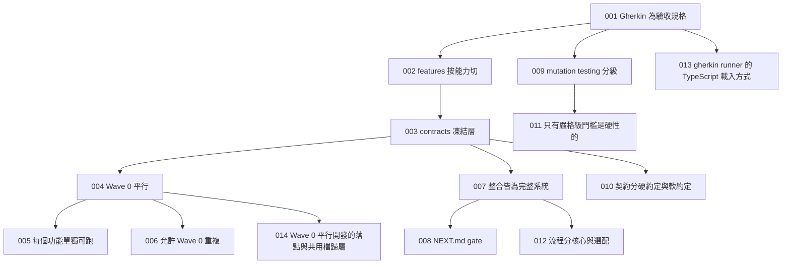

# Decision Map

所有有取捨的決定,ADR 格式,只增不刪。被推翻的標 `superseded`,不刪除——
決策地圖的價值就在於看得到「當初為什麼這樣想、後來為什麼改」。

新增用 `/decide`。

## 怎麼讀

- **Status**:`accepted` 生效 / `superseded by ADR-XXX` 被推翻 / `proposed` 待確認
- **Context** 當時的情況與限制 · **Decision** 決定了什麼 · **Alternatives** 沒選的
- **Consequences** 好處與代價 · **Related** 相關 ADR 與 feature
- 標「來源:範式」的 ADR 是這套開發範式本身的決策,不是你這個專案的產品決策——
  它們解釋「為什麼流程長這樣」,不需要因為你的產品不同而重新論證,除非你真的想推翻它

## 依賴圖

---

## ADR-001 · 用 Gherkin 當驗收規格與測試

- **Status**: accepted · {{TODAY}} · 來源:範式
- **Context**: 需要一種「規格即測試」的機制,讓「做完了」有明確、可自動驗證的定義,而不是憑感覺。
- **Decision**: 每個 phase 一個 `.feature`,cucumber 執行。人眼才能判斷的場景標 `@manual`。沒有 gherkin 不開工。
- **Alternatives**: 只寫單元測試(規格散落在測試斷言裡,新人或 AI 看不出「為什麼」);先寫文件需求規格再寫測試(兩份東西容易脫節)。
- **Consequences**: 多一層要維護的檔案。換來的是規格與測試是同一份東西,不會脫節。
- **Related**: ADR-002, ADR-013, features/README.md

## ADR-002 · features/ 按能力切,不按里程碑切

- **Status**: accepted · {{TODAY}} · 來源:範式
- **Context**: 一個能力常常橫跨多個開發階段;如果按階段(里程碑)切資料夾,同一個能力的 gherkin 與程式碼會散落在好幾個地方。
- **Decision**: 一個能力一個資料夾,內含多個 phase。roadmap 負責把這些能力對應到 wave / integration 的時間軸上。
- **Alternatives**: 按里程碑切(`milestone-1/`、`milestone-2/`……);按技術層次切(`backend/`、`frontend/`)。
- **Consequences**: 資料夾結構穩定,不會因為排程調整而重新搬檔案。代價是「這個里程碑要做什麼」要另外查 roadmap,不能只看資料夾列表。
- **Related**: ADR-001, ADR-003

## ADR-003 · 新增 contracts/ 凍結層

- **Status**: accepted · {{TODAY}} · 來源:範式
- **Context**: 想要多個功能從一開始就能完全平行開工。平行的唯一障礙是「A 需要 B 的型別才能動」。
- **Decision**: 抽出 `contracts/`:所有跨模組型別、檔案格式、函式簽章、路由表、fixture 規範。Wave 0 開始後凍結,修改硬約定需要 ADR 並列出要重驗的 phase。
- **Alternatives**: 讓某個「基礎」功能先做完當前置(那樣就沒有平行);每個模組自己定義介面,整合時協調(整合會撞成一團)。
- **Consequences**: 多一層要維護。改契約成本高——這是刻意的。換來多個資料夾真正平行開發的可能性。
- **Related**: ADR-002, ADR-004, ADR-010, contracts/

## ADR-004 · Wave 0:所有 phase-1 完全平行,禁止跨資料夾 import

- **Status**: accepted · {{TODAY}} · 來源:範式
- **Context**: 想要第一階段完全平行,但平行開發最容易被「其實我需要另一個資料夾還沒寫完的東西」悄悄破壞。
- **Decision**: 每個資料夾的 phase-1 只能 import `contracts/` 與自己的目錄。需要別人的能力就用 contract 介面 + 自己的 stub。這條由邊界檢查腳本強制執行。
  一個例外:**組合層**(把其他模組串起來的薄薄一層)在被組合的東西存在之前無法獨立,硬造一個吃 stub 的版本等於重工——這種能力可以不參與 Wave 0,但要在 `FEATURE.md` 說明理由並記一筆 ADR。
- **Alternatives**: 允許依賴但排順序(那就不是平行了);只讓部分資料夾平行(複雜度不減、好處減半)。
- **Consequences**: 多個資料夾可同時開工。代價是 Wave 0 有重複(見 ADR-006)。
- **Related**: ADR-003, ADR-005, ADR-006

## ADR-005 · 每個功能必須能單獨執行,整合後仍然要能

- **Status**: accepted · {{TODAY}} · 來源:範式
- **Context**: 沒有一個永遠有效的耦合檢測器,模組會在整合過程中不知不覺黏死。
- **Decision**: 每個 `FEATURE.md` 有「單獨執行」段落,寫一行可複製的指令,並登記進 `standalone.json`。`/phase-done` 實際執行它。整合後仍須能跑——這是刻意的耦合約束。
- **Alternatives**: 只在 Wave 0 要求(那整合後模組會慢慢黏死)。
- **Consequences**: 每個模組要有 CLI 或等價的獨立入口,是額外工作。換來的是模組永遠可以單獨 debug,以及一個永遠有效的耦合檢測器。
- **Related**: ADR-004

## ADR-006 · 接受 Wave 0 的重複,整合時移除

- **Status**: accepted · {{TODAY}} · 來源:範式
- **Context**: 平行的代價是幾份重複的 stub / 假實作(例如每個需要外部服務的功能各自寫一份 fake)。
- **Decision**: 接受。每個 `FEATURE.md` 有「Wave 0 的重複」表,列出東西、位置、在哪個整合點移除。整合驗收時逐一檢查是否真的移除。
- **Alternatives**: 為了避免重複而排順序(等於放棄平行)。
- **Consequences**: 一點重複遠比一個依賴鏈便宜。額外好處:兩份獨立實作對同一份 fixture 算出不同結果,就代表契約有歧義——這種檢查只有在有兩份獨立實作時才做得到,錯過就沒了。
- **Related**: ADR-004

## ADR-007 · 每個整合點都必須是完整可用的系統

- **Status**: accepted · {{TODAY}} · 來源:範式
- **Context**: 「整合到一半」的系統是專案風險的主要來源之一——如果專案在某個時間點被迫停下,手上最好有個能用的東西。
- **Decision**: 每個整合點的驗收 gherkin 都必須有至少一個 `@e2e` 場景描述「一個人從頭到尾做完一件有意義的事」。寫不出這樣的場景,代表整合點切錯了,要重切。每個整合檔另有 `@regression` 場景驗證前一個整合點沒被弄壞。
- **Alternatives**: 按技術層次整合(先全部後端再全部前端)——那樣中間好幾個月沒有可用的東西。
- **Consequences**: 第一個整合點通過之後系統就有價值。專案在任何整合點停下來,手上都有能用的東西。代價是整合點的切法受限,不能純粹按技術方便切。
- **Related**: ADR-003, ADR-008, docs/integration/

## ADR-008 · 每個資料夾用 NEXT.md 管理 gate

- **Status**: accepted · {{TODAY}} · 來源:範式
- **Context**: 需要在資料夾層級告訴協作者(人或 AI)「下一步是什麼、什麼時候可以開始」,而不是只在全域的 roadmap 裡集中管理。
- **Decision**: 每個資料夾一個 `NEXT.md`:目前狀態、下一個 phase 的 gate(自身 / 整合 / 契約三類)、gate 未滿足時該做什麼、完成後解鎖什麼。排程時讀它決定 ready,不手動改狀態。
- **Alternatives**: 只在 roadmap 集中管理(在資料夾內工作時看不到);只靠 `FEATURE.md` 的依賴表(說得出「等什麼」但說不出「現在該做什麼」)。
- **Consequences**: 「gate 未滿足時該做什麼」是最有價值的段落——它防止協作者在等待時瞎猜介面、寫出要重寫的程式。
- **Related**: ADR-007

## ADR-009 · 導入 mutation testing 並分三級門檻

- **Status**: accepted · {{TODAY}} · 來源:範式
- **Context**: 行覆蓋率抓不到「執行到但沒驗證」的測試。專案裡通常有一部分邏輯(排程、計分、驗證、路徑防護一類)算錯的代價是延遲很久才被發現。
- **Decision**: 用 Stryker(或等價工具)。三級門檻:嚴格(核心純函式與安全邊界)、標準(有 IO 或外部依賴的邏輯)、寬鬆(adapter、CLI、UI 元件,不強制)。驗收前必跑。
- **Alternatives**: 只用行覆蓋率(抓不到「執行到但沒驗證」);全專案統一門檻(對 UI 追高分沒有意義,會浪費時間)。
- **Consequences**: 驗收變慢。換來核心邏輯的信心。明確禁止「為衝分數寫斷言」——那會在重構時變成阻力。
- **Related**: ADR-011, .claude/skills/mutation-testing/

## ADR-010 · 契約分硬約定與軟約定

- **Status**: accepted · {{TODAY}} · 來源:範式
- **Context**: 把整份契約都凍死太重——型別改了編譯器會抓、測試會抓,走 ADR 是儀式不是保護。但磁碟格式改了會讓已產生的資料失效,需要更審慎的流程。
- **Decision**: **硬約定**(磁碟格式、跨模組共用的任務常數與路由表)改動需要 ADR。**軟約定**(記憶體介面、函式簽章)改了跑測試、更新契約文件、commit 說明理由即可。
- **Alternatives**: 全凍(太重);全不凍(協作者跨 session 會漂移)。
- **Consequences**: 改函式簽章不再是一場儀式。磁碟格式仍然受保護。契約升版遵照語意化版本。
- **Related**: ADR-003, contracts/README.md

## ADR-011 · 只有嚴格級的變異門檻是硬性的

- **Status**: accepted · {{TODAY}} · 來源:範式
- **Context**: 讓驗收在任何變異測試門檻未達標時都擋住,對 UI 與 adapter 這類程式碼是浪費時間。
- **Decision**: **嚴格級未達 → 擋住驗收**,因為那些模組算錯的代價是延遲很久才顯現。**標準級未達 → 回報但不擋**,由使用者決定要不要處理。**寬鬆級 → 不跑。**
- **Alternatives**: 全部硬性(拖慢驗收速度);全部軟性(核心邏輯的測試品質會鬆掉)。
- **Consequences**: 驗收變快。代價是標準級模組的測試品質靠自律。這個取捨是刻意的:嚴格級涵蓋了所有「錯了會靜默」的地方。
- **Related**: ADR-009

## ADR-012 · 流程分核心與選配,可以只用核心

- **Status**: accepted · {{TODAY}} · 來源:範式
- **Context**: 這一整套流程(契約、gherkin、Wave 0、NEXT.md、sprint、mermaid 依賴圖、分級變異測試……)對小團隊或個人加 AI 配對開發來說偏重,重到會被放棄。
- **Decision**: 明確區分**核心**(契約、gherkin、phase 驗收的測試與單獨執行檢查)與**選配**(sprint 檔、整合驗收的完整清單、decision map 的 mermaid 圖、標準級變異測試)。`03-agile-workflow.md` 的「最小模式」段落說明只用核心怎麼跑。
- **Alternatives**: 全部必做(會被放棄);刪掉選配的部分(專案長大時會後悔)。
- **Consequences**: 流程是為了保護你不犯已知的錯,不是為了被遵守而存在。用不到就關掉,需要時再開。
- **Related**: ADR-007, docs/03-agile-workflow.md

## ADR-013 · gherkin runner 的 TypeScript 載入方式要明確決定,不要留給預設值猜

- **Status**: accepted · {{TODAY}} · 來源:範式
- **Context**: 用 TypeScript 寫 cucumber 的步驟定義時,ESM + TypeScript 的載入方式(ts-node / tsx / 先編譯)有好幾種選項,選錯或設定檔格式錯了,錯誤訊息往往是「所有 step 都是 undefined」,很難第一時間定位到是設定問題而不是步驟寫錯。
- **Decision**: 用 `tsx` 的 `--import` ESM loader。驗收腳本前綴 `NODE_OPTIONS=--import=tsx`;runner 設定檔(如 `cucumber.js`)的 `paths` / `import` / `tags` 要照著官方 schema 寫在頂層,不要多包一層物件——多包一層會讓設定被安靜忽略,不會報錯,只會讓所有步驟變成 undefined。步驟檔之間互相 import 用 ESM 慣例(`./_world.js`,執行時對應到 `.ts`)。
- **Alternatives**: ts-node/esm(維護較慢、ESM 支援不穩);先編譯再跑(多一步建置)。
- **Consequences**: 整個 repo 的 TypeScript 執行只有一條路。換平台(例如要在 Windows 上跑)時,`NODE_OPTIONS=` 這種前綴語法可能要改用跨平台寫法,到時再處理。
- **Related**: ADR-001, features/steps/README.md

## ADR-014 · Wave 0 平行開發的落點與共用檔歸屬

- **Status**: accepted · {{TODAY}} · 來源:範式
- **Context**: 多個 phase-1 各開一個 git worktree 同時做時,互踩只會發生在共用檔與同一個目錄,所以要在分叉前定好,而不是撞到了才處理。
- **Decision**:
  1. 落點表要在一個固定的地方(例如 `packages/core/README.md`),邊界檢查腳本的 OWNERS 表是同一份表的程式版。每個功能一個自己的原始碼子目錄(含自己的 stub)。
  2. 如果有共用的展示層 / UI 元件庫,明確指定 Wave 0 期間由哪個功能擁有,其他功能在對應的整合點之前不 import 它。
  3. **共用檔只有協調者改**:`package.json`、lock 檔、`tsconfig.json`、runner 設定檔、`standalone.json`、`features/steps/_world.ts`、`features/steps/common.steps.ts`、roadmap、本檔。worker 把需求寫在自己 `FEATURE.md` 的「待協調」段。
  4. **出現在兩個以上資料夾的 gherkin 句子只在 `common.steps.ts` 定義一次**;只用在 `@manual` 場景的句子不定義(cucumber 對重複定義會報錯,這是刻意利用來強制統一措辭)。
  5. 所有依賴一次裝在 root(workspaces hoisting),worktree 只跑 `npm ci`,不動 lock。
  6. 合併順序與合併後的檢查清單要先講好(通常是:產出 fixture / 契約可執行版本的能力先合併,其餘隨到隨合;每次合併後跑邊界檢查、單元測試、standalone 驗收、standalone 檢查腳本)。
- **Alternatives**: 各 worktree 自己加依賴與 workspace(lock 檔幾乎必衝);允許兩個功能同時寫同一個共用元件庫(同檔互踩)。
- **Consequences**: worker 的自由度小一點,但合併幾乎不會衝突。「WIP ≤ 2」的建議在 Wave 0 期間可以暫時放寬(因為 Wave 0 的並行不是同一個人同時做,而是多個角色/多個 worktree),Wave 0 之後恢復。
- **Related**: ADR-004, ADR-005, ADR-006, packages/core/README.md(如果是 monorepo), scripts/check-boundaries.ts

---

## 待決(不影響開工)

| 項目 | 需在何時前決定 | 阻擋什麼 |
|---|---|---|
| {{PENDING_DECISION_1}} | {{PENDING_BEFORE_1}} | {{PENDING_BLOCKS_1}} |
| {{PENDING_DECISION_2}} | {{PENDING_BEFORE_2}} | 無 |

這張表是給你的專案自己的待決事項用的,上面兩列只是範例,可以直接刪掉重寫。
規則:**待決事項不阻擋開工**,只阻擋某個明確標出來的 phase——如果一個待決事項
擋住了大半個專案,它其實已經不是「待決」而是「該現在就決定」,回去問使用者。

## 已推翻

(目前無。被推翻的 ADR 保留在上方並標 `superseded by ADR-NNN`,這裡列索引:
`- ADR-XXX 被 ADR-YYY 推翻:一句話原因`)
