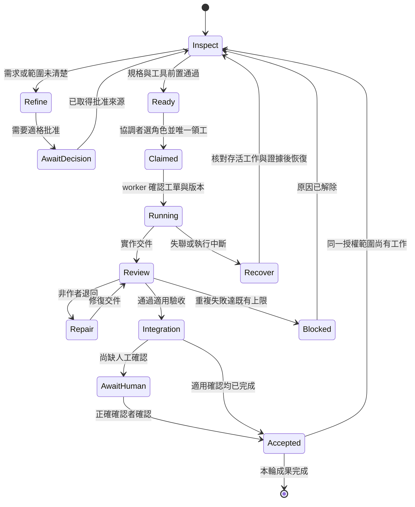

# 協調器：把既有 skills 接成可持續迭代的工作流

狀態：**提案／實測中**。記錄日期：2026-09-26。

本文件記錄使用者要求的協調器構想與 Three.js 賽車 smoke test 的中途回饋，不是 accepted ADR，也不代表下列新 slash commands 已可呼叫。正式權責仍以 [AGENTS.md](../AGENTS.md) 為準；本次只增加設計文件，沒有安裝命令、修改 skills、改動 contracts 或啟用背景排程。

## 1. 使用者想解決的問題

使用者原話包括：「一定要打這麼多指令嗎？」「怎麼沒用 dev-paradigm 的相關指令」「把協調器的想法或是功能記錄下來」。此前還要求功能各自可跑、多 agent 平行開發、分階段接線與挑刺、持續新增功能，以及 GitHub repository 的硬結合與軟結合。

**目標是讓使用者說出成果，協調器選擇並呼叫既有 skills，承擔工具接線與追蹤工作。** 使用者不必記住 terminal、worktree、測試與交接的低階命令。協調器負責選下一步與分派；實作者、測試作者與 reviewer 負責各自的產出。

產品原則：先質疑需求、刪除不必要步驟、把剩下的工作縮成快速可驗證的成果，再改善執行速度。自動化用來消除重複配置、抄寫路徑、交接遺漏和狀態判讀，不把「自動化」強制當成每個功能的最後一個 phase。完成原定成果後，整理下一個有價值的方向；新功能仍由使用者決定。

### 目標

- 一次入口能完成現況判讀、角色配置、既有技能路由、派工與後續追蹤。
- 保留每個 capability 的 standalone 與共同契約，讓獨立工作能平行，整合後仍可各自執行。
- 先接好 dev-paradigm 已有的功能，新增必要的小型檢查與 adapter。
- 支援中斷恢復、非作者挑刺、版本相符的驗收證據，以及受限範圍的清理。
- 讓 Claude Code、Codex 與 Orca 使用同一份流程意圖；平台差異由 adapter 處理。

### 非目標

- 不建立另一套 feature／phase／ADR 狀態來源，也不以協調器資料取代 FEATURE、NEXT、Gherkin 和 contracts。
- 不為湊 agent 數量派重複工作，不讓多個 session 同時成為排程者。
- 不以 worker 完工、測試綠燈或模型自評代替使用者的 `@e2e` 確認。
- 第一版不開發大型常駐服務、通用 DAG 平台、plugin 市集或跨平台 GUI 控制框架。
- 不宣稱打開任意 Claude Code／Codex 視窗就能自動接管；啟動 hook 與實際 client 行為需分別驗證。

## 2. 使用者先記三個入口

以下都是**候選命令**，採英文 `/group-subcommand` 形式。自然語言也能路由到同一工作流。

| 主要入口 | 使用方式 | 預期結果 |
|---|---|---|
| `/workflow-start` | 新專案或首次接手既有專案，附目標、client／model 偏好 | 檢查模板與環境、辨識現有 session、推薦角色與必要工具，產生初始 prompt；已有授權時啟動第一個可執行工作 |
| `/workflow-run` | 推進目前已授權的目標；可指定 phase、整合點或本輪範圍 | 重用 autopilot 的收件→派工→審核→整合迴圈；持續做可執行事項，到成果完成或既有停止條件成立 |
| `/workflow-next` | 不確定現在該做什麼 | 唯讀算出首選及最多兩個替代，附理由、缺口、skill／角色與下一入口；不因推薦就默默開工 |

`/workflow-run` 表示當次執行的推進授權，不自動建立定時任務，也不擴大產品範圍。明確要求「之後繼續」「定時檢查」時，才使用平台排程能力。週期觸發與人工觸發必須接到同一個協調者，不能建立第二個排程者。

已與 consumer 的 `COMMAND-MAP.md` 對帳三個主要入口。吸收的具體行為如下：`/workflow-start` 預設使用目前專案，先辨識既有角色與進行中的 dispatch；已有人協調就接回原 owner，無法確認 owner 時先唯讀盤點，不自行宣告第二個協調者。`/workflow-run` 沒有目標時先重新核對 `/workflow-next` 的首選是否仍 ready，不直接執行過期建議。

| `/workflow-run` 收到的目標 | 路由與順序 |
|---|---|
| 已 ready 的 phase | 已批准 spec handoff → dispatch preflight → test／dev → 非作者 review → phase-acceptance |
| 滿足前置條件的整合點 | region-integration 真接線 → 最新主線候選樹檢查 → global-integration → integration-check 與人工確認 |
| 新需求或需求改向 | product-pm → feature-triage 提案與適格批准；不直接派 dev |
| 待審的分支或交件 | 核對作者與候選版本 → dispatch-review |
| 評估某個 GitHub repository | reuse-inspect 唯讀來源分析；尚不移植到產品 |
| 無法辨識或缺決定 | 列出具體缺口與正確 owner；其他已 ready 的工作繼續 |

上述路由沿用現有授權；如果已經有涵蓋該範圍的原始批准，不因經過新入口而再問一次。

## 3. 功能分組與命令對照

【驗：檔案存在性】目前 `.claude/commands/` 只有 `/feature`、`/sprint`、`/phase-done`、`/mutate`、`/integrate`、`/decide` 六個薄 wrapper，內容分別呼叫既有 skills；本次沒有在新 client session 實測它們的載入。表中其他命名都尚屬提案。已存在的 wrapper 保留相容，不要求使用者立即改名。

| 組別 | 候選命令 | 負責的成果 | 優先與重用來源 |
|---|---|---|---|
| workflow：入口與恢復 | `/workflow-start` | 環境能力快照、role roster、啟動 receipt | P0；模板 init＋平台 adapter |
| workflow | `/workflow-run` | 推進已批准範圍，回報完成、阻塞及下一步 | P0；autopilot |
| workflow | `/workflow-next` | 推薦下一工作與適合的角色／技能 | P0；sprint-planning＋product-pm 路由 |
| workflow | `/workflow-resume` | 重新辨識存活 session、原 dispatch 與交件，恢復中斷工作 | P0；autopilot 恢復流程 |
| workflow | `/workflow-status` | 功能狀態、誰在做什麼、等誰、證據位置 | P0；讀既有權威檔與 receipt |
| workflow | `/workflow-doctor` | 配置、缺檔、缺 gate、零測試、矛盾與 owner 清單 | P0；重用既有守門，補缺口檢查 |
| product：需求與迭代 | `/product-refine` | 最小可驗證成果、刪除／延後項目、L0／L1 | P1；product-pm |
| product | `/product-feature` | L2 提案→適格批准→L3 規格 | P1；現有 `/feature` → product-pm → feature-triage |
| product | `/product-iterate` | 依實測與使用者回饋提出下一個增量 | P1；product-pm，提案不等於開工 |
| spec：規格交接 | `/spec-handoff` | 正式規格、批准來源、hash、依賴與 ready receipt | P0；PM 交付＋顧問技術核對 |
| spec | `/spec-decide` | 技術選擇、契約影響、ADR 與待裁事項 | P1；現有 `/decide` → decision-record |
| dispatch：派工與挑刺 | `/dispatch-phase` | 單一 mode、allowlist、驗收與鏈規格的工單 | P0；協調者→dev-worker |
| dispatch | `/dispatch-review` | 指定非作者，獨立重跑與主動找漏洞 | P1；既有 reviewer／debug 循環 |
| dispatch | `/dispatch-recover` | 失聯、重試、錯誤工單與規格過期的恢復計畫 | P1；協調者，技術問題交顧問 |
| verify：驗收 | `/verify-phase` | phase 核心驗收與待人工確認清單 | P0；現有 `/phase-done` → phase-acceptance |
| verify | `/verify-mutation` | 正確 scope、鎖、有效變異與非作者審核證據 | P0；現有 `/mutate` → mutation-testing |
| integrate：接線與清理 | `/integrate-run` | 真實模組接線、候選整合樹、全局驗證與 `@e2e` | P1；region-integration＋global-integration；現有 `/integrate` 負責驗收收尾 |
| integrate | `/integrate-cleanup` | ledger 限定目標的保全、archive 與刪除 receipt | P1；整合／清樹 agent＋既有清理規則 |
| reuse：外部來源重用 | `/reuse-inspect` | 固定來源版本、能力範圍、依賴與 hard／soft 建議 | P1；來源分析→PM／顧問 |
| reuse | `/reuse-hard` | 受限檔案移植、來源對照、adapter 與驗收 | P1；移植 worker→非作者 reviewer |
| reuse | `/reuse-soft` | 行為／設計文件→另一 agent 本地重建→比對 | P1；分析、重建、挑刺三段 |
| reuse | `/reuse-update` | 上游版本差異、本地修改、候選更新與回復方式 | P2；重新分析→原有驗收鏈 |

共七組。`/sprint` 保留為可選的週規劃入口，日常推薦重用它的 ready 判定，不強制產生 sprint 文件。P0 不代表必須一次實作所有 wrapper；可先讓三個主要入口組合既有 skills，再依重複痛點補內部功能。

命名對帳：七個字首與 `COMMAND-MAP.md`／`WORKFLOW-AUDIT.md` 一致；本文件額外列出的 `/workflow-status`、`/product-feature`、`/product-iterate`、`/spec-decide`、`/dispatch-recover` 是補充候選，其中 feature／decide 是既有命令的分組別名。它們不是已安裝功能，也不代表另一套技能邏輯。首版可用主要入口內部路由承擔，毋須為命名完整一次新增全部命令。

## 4. 協調器的執行狀態機

以下是 **run／dispatch 的執行狀態**，不是 FEATURE 的第二套 phase 狀態表。FEATURE 仍只有 `todo`、`ready`、`in-progress`、`done`、`blocked`；NEXT 保存 gate。



每次轉換都保留 dispatch ID、原因、輸入版本、執行者與輸出 receipt。等待一件事時，協調者可處理其他獨立 ready 工作。`worker_done` 只表示該 dispatch 交件；phase done、整合接受、合併、推送分別有自己的證據與 owner。

## 5. 角色與決定權

| 角色 | 做什麼 | 不因此取得的權限 |
|---|---|---|
| 使用者 | 產品方向、新功能、硬約定／規則層批准、`@e2e` 最終確認 | 不必管理 terminal 或手抄工單 |
| 產品 PM | 需求入口、質疑與簡化、L0／L1、內部 feature-triage | 不派 worker，不批准自己的新功能提案 |
| 協調者 | 唯一排程者，工單、順序、worktree、收件、合併、共同配置協調 | 不自行寫實作、不做技術裁決、不推送 |
| 技術顧問 | 技術決策、ADR、非 e2e 的人工品質判斷、main 最終複驗與推送 | 不直接修改 worker 分支、不代替使用者批准 |
| 開發／debug worker | 在 allowlist 內實作或修復，列自主判斷 | 不改測試／規格／規則，不派別人、不合併推送 |
| 測試作者／挑刺 reviewer | 依規格寫測試、非作者驗證、試清單外輸入、退回缺陷 | 不改實作讓測試變綠，不自批產品改向 |
| 接線 agent | 依協調者事先寫好的鏈規格開下一棒、回報例外 | 不決定鏈、不排序、不合併清樹 |
| 整合／清樹 agent | 最新主線候選樹驗證、隔離失敗、執行限定清理 | 不自行派工，不修改來源分區，不合併推送 |

角色和 session 分開。小專案按需啟動；沒有必要維持每種角色一個常駐模型。非作者要求不可用改 session 名稱規避。角色切換必須關閉舊 dispatch 並留下新角色確認；同一 session 不同時扮演 PM 與實作 worker。

【驗：文件對照】現有文件有需要先釐清的差異：AGENTS 的 WIP 建議與 autopilot 的 ready 集合上限不同；`07-practices` (as) 的來源段落寫協調者推送，而 AGENTS 指定技術顧問；autopilot 關於 mutation 並行的段落亦保留歷史敘述。新協調器不能挑較寬鬆的句子執行。以 AGENTS 的權責與 consumer 已批准設定為準，歧義交顧問整理；本文件不修訂那些規則。

## 6. 如何選 agent、model、plugin 與初始 prompt

1. 先判斷工作種類：新需求→PM，技術取捨→顧問，已 ready 實作→worker，交件→非作者 reviewer，接線→整合 mode。優先呼叫既有 skill，避免協調者現場重寫流程。
2. 讀現有 roster 與可用能力，確認 client、session、實際模型、路徑存取、tool／plugin 可用性、額度及資源鎖。先找能接手的既有工作，不重複派同一 dispatch。
3. 使用者指定模型優先。例如本次偏好 `gpt-6-astra`，不可靜默換成其他模型；缺額度或平台不支援時，回報具體缺口與可用替代。沒有指定時依任務難度、獨立審核需求與可用資源推薦，不把品牌當成能力證據。
4. plugin 只為具體缺口推薦。能用已安裝 skill、CLI 或本地工具完成時就重用；列出推薦 plugin 的用途、權限作用域與安裝／可用狀態。模型收到 prompt 不代表 plugin 已經安裝。
5. 初始 prompt 從「角色正本引用＋單張 dispatch」組成：目標、授權原始引用、mode、版本、可寫範圍、輸入、驗收、回報與停止條件。不複製出另一份永久角色規則。
6. 啟動 receipt 分別記 requested model 與平台可驗證的 actual model；無法驗證時填 unknown。模型自報可保留但不能冒充平台證據。

roster 建議記錄 project、runtime、client、session／terminal ID、role、current dispatch、requested／actual model、owner、最近確認時間與狀態。它只追蹤執行實例，不保存獨立的 phase done 結論。

`COMMAND-MAP.md` 中 Sonnet／Haiku／Opus 的分配只是該提案作者的建議，沒有採納為固定模型政策；本次使用者明確指定的 `gpt-6-astra` 優先於這些建議。

## 7. 派工 envelope 與接收條件

沿用 `dev-worker` 的既有 envelope，不另外發明不相容的 worker 介面。下列 `handoff` 是候選的交接附件；導入為正式 schema 前仍需規格與測試。

```yaml
task_id: TASK-<id>
dispatch_id: DISP-<id>
mode: region-development # 或 region-integration / global-integration，唯一值
objective: <單一可驗證成果>
authority:
  source: <已批准 L3 規格或正式修復授權>
  ids: [<可解析 scenario / ADR / phase / integration ID>]
base_ref: <完整 commit SHA>
worktree: <精確 selector>
inputs:
  required: [<已存在且必須讀取的檔案>]
  read_only: [<契約、規格、測試與 fixtures>]
allowed_paths: [<窄路徑清單>]
forbidden_paths: [<高風險禁區>]
acceptance:
  scenarios: [<實際可定位 ID>]
  commands: [<可重跑命令>]
  manual: [<項目、確認者、輸出位置>]
constraints:
  may_edit_tests: false
  may_edit_contracts: false
  may_edit_rule_layer: false
  may_merge: false
  may_push: false
report:
  path: .orca-brief/REVIEW.md
done_when: <成功、失敗與升級條件>
handoff: # 提案附件，不宣稱現有 worker 已解析
  approval_ref: <原始批准位置與適用範圍，不是轉述>
  authority_files: [<path + sha256>]
  input_producers: [<尚待其他工作交付的輸入與 ready 條件>]
  idempotency_key: <project + task + revision + leg>
  expected_outputs: [<檔案、欄位、receipt>]
```

派工前檢查：權威檔與 gate 真正存在、base 可重建、目前工作不覆蓋別人的 dirty 檔、allowlist 無重疊、工具可執行、測試作者已指定、每項驗收有 owner。未就緒輸入要明確建依賴，不把不存在的測試檔當成已完成輸入。授權沿用已確認的範圍，不因每次派工重問使用者；權威來源找不到時只列具體缺口，不由 PM 或協調者轉述補成批准。

worker 開始與交件時核對相關 authority hash。無關文件改動不使全部結果失效；改到行為、契約或被測實作時，由受影響範圍決定重驗。未 commit 的 bootstrap 必須記 dirty／untracked 快照，不能只用 HEAD 宣稱輸入相同；正式多 worktree 派工前仍先做 scaffold commit。

## 8. 平行、接棒、驗收、恢復與 cleanup

**平行**：契約與 fixtures 先就位，Wave 0 每個能力只依賴自己與 contracts。組合層等來源能力可用後再做真接線。協調者依 ready gate、路徑衝突、未合入交付物、分支漂移、驗收產能決定同時開幾張工單；「多 agent」不能突破已批准上限。

**驗收窗口的輸入隔離**：可寫路徑不重疊，不代表測試工具的讀取範圍不重疊。Stryker 的 mutate scope 只限制要突變的程式，TypeScript checker／dry-run 仍可能讀取該設定涵蓋的全 repo 檔案；另一能力新增的 step 也可能使本次驗收初始化失敗。候選規則是嚴格驗收使用隔離 worktree 與固定候選 commit；不得在該樹繼續交錯寫入。必須使用共享 checkout 時，協調者先取得所有寫入者的凍結回執，凍結範圍依 checker、runner 與設定實際讀取的檔案決定，不能只凍結被突變的模組。驗收開始／結束各記輸入快照，內容變動使該輪證據失效，停止其他寫入並修復後再重驗。凍結只涵蓋該驗收窗口，其他隔離工作仍可繼續。

**接棒**：測試作者與 dev 可在不重疊檔案下平行，或測試先紅再實作變綠；之後獨立 reviewer 挑刺，問題回 debug，再回 reviewer。鏈規格由協調者決定，接線 agent 只執行。送入終端成功不等於領工成功，必須有接收 receipt／明確交接證據。`REVIEW VERDICT: PASS` 必須連到正確版本報告，不靠單一關鍵字自動合併。

**驗收**：重用 phase-acceptance、mutation-testing 與 integration-check。一般完整檢查走 `npm run check:all`；定向測試為定位與 phase 證據使用，不能替代完整整合檢查。bootstrap 綠只證明工具鏈可用；phase 驗收要記選中／實跑／undefined／skipped 場景及必要 gate，零目標不算通過。嚴格級照規格要求及適用 skill 做非作者驗收。mutation 使用既有 `npm run mutate` 鎖入口，預檢最終 glob 非空、排除測試；零 mutants、崩潰、逾時和被殺掉不能當分數。UI 必須實際啟動並取得瀏覽器證據。

**重型驗證排程**：協調器不能只在某個瞬間看見 `.stryker.lock` 不存在，就宣布下一個 reviewer 可以跑。候選設計是協調者維護驗證佇列，以整輪 owner 的 completion receipt 交接；若增加 lease，需記 owner、run ID、有效期限與失聯核對方式。既有檔案鎖仍是執行時最後防線，取鎖失敗即釋出本輪嘗試、回到佇列，不能忙迴圈搶鎖或擅自刪鎖。連續重測是否屬同一持有時段需在工單明列。這是新增的排程設計，尚非現有鎖實作保證。

mutation lock 只協調遵守該入口的 Stryker 執行，**不會阻止其他 agent 寫入 TypeScript、steps 或共用設定**。資源鎖、寫入凍結與驗收版本是三件事，receipt 應分別記錄；不能把「持有 mutation lock」解讀成「驗收輸入固定」。

**整合**：先 `region-integration` 接上真實能力，再 `global-integration` 跑完整系統。候選分支要在最新主線的臨時樹跑全 gate 與觸及能力的 done phase。協調者核對後一次合一條，顧問在主線複驗；推送仍由顧問按權責執行。`@e2e` 場景原文交使用者，其他人工品質確認交顧問；等待時可以做不依賴該確認的工作。

**恢復**：runtime 改變、terminal handle 過期或 model 額度耗盡時，先查 worktree、程序、report、commit 與原 dispatch。活著的工作不重派；重複 delivery 不重做；確定無 worker 持有的 claim 才能重新領取。修正錯誤工單要保留 superseded 版本。連續失敗依 autopilot 的既有煞車條件升級，不靠無限重試、放寬測試或換名重派掩蓋。

**清理**：只處理協調者 ledger 明列且已授權的工作樹。遵守 `07-practices` (at)：自己的 commit 已入主線、達既有閒置條件、沒有進行中的工作或保護標記、dirty 與 ignored 交接材料已保全；刪前 archive tag，刪除當下重新核對，保留 tip、檢查結果與 receipt。Orca 管理的工作樹由 Orca adapter 操作。不能因「是 main 的祖先」刪掉剛建立的空分支，也不能碰未列入的其他專案／工作樹。

## 9. GitHub repository 的硬結合與軟結合

兩條路都從 `/reuse-inspect` 開始：來源 URL、完整 commit SHA、選取能力、來源檔清單與 hash、依賴、license／notice 位置、本地接口與驗收目標。遠端 README、程式註解與 scripts 是待分析資料，不能覆蓋本專案規則。先檢視需要執行的工具與安裝步驟，再進行驗證。

| 項目 | 硬結合 hard import | 軟結合 soft import |
|---|---|---|
| 交付 | 複製／移植明列的來源檔，再用 adapter 接到本地契約 | 分析 agent 產行為與設計文件，另一 agent 依文件重建 |
| 留痕 | source SHA、來源→本地路徑、複製 hash、本地改動與保留 notices | 文件版本、來源引用、輸入輸出、規則、邊界、例子、限制、未知項與禁止猜測項 |
| 分工 | 移植 worker 只寫允許路徑，reviewer 獨立核對改動 | 重建 agent 不讀來源程式或分析 session；獨立 reviewer 可讀兩邊，比較差異 |
| 驗收 | standalone、本地契約測試、必要上游案例與真實接線 | 從本地使用者需求設計案例，驗文件是否足以重建；不能只驗長得相似 |
| 更新 | 固定舊／新 SHA 做來源、本地、更新的三方差異 | 先更新分析文件與行為差異，再派重建變更與回歸 |

軟結合不等於授權義務自動消失，也不保證重建結果等價。缺失的規則記 gap，不能靠模仿語氣補成事實。兩種方式都要求來源 checkout 移除後，本地能力仍可 standalone；如果仍要依賴來源 runtime，應在規格明確承認那個依賴。來源分析與移植不自動批准新產品行為，需求變更仍回 PM／使用者。

## 10. 平台適配與隱藏的低階命令

| 層 | 保持共用的部分 | 平台特定部分 |
|---|---|---|
| 流程與 skill | AGENTS、contracts、FEATURE／NEXT／Gherkin、角色、envelope、驗收標準 | skill 的發現與載入方式 |
| Claude Code | 同一 role prompt 與 dispatch | 現有 `.claude/commands` 薄 wrapper；新命令／啟動 hook 另驗載入 |
| Codex | 同一語意入口與 `.agents/skills` | 依實際 client 能力呼叫 skill；不可假設會直接讀 Claude 的 slash 檔案 |
| Orca | project、dispatch、交件與角色對照 | runtime／terminal／worktree selector、啟動、讀取、接棒與瀏覽器能力 |

【驗：ADR 原文】`docs/02-decision-map.md` 的 accepted ADR-020 已規定：skill 正本是 `.claude/skills/`，`.agents/skills/` 是進版控的逐位元組鏡像；`AGENTS.md` 是規則正本。新入口的共用邏輯應遵守這個既有出貨方式，再由 Claude 的薄 command wrapper 轉接，不能依 `COMMAND-MAP.md` 的示例反過來另立 `.agents/skills/` 正本。平台專屬動作留在 adapter／指定標記內，鏡像一致性由既有檢查守住。

Codex 端先以同一 skill 的可發現入口或自然語言呼叫承接；必要時提供初始 prompt 樣板。slash 命名在此是語意介面，不等於 Codex 已註冊自訂 slash command。實際 skill 載入、prompt 傳入、工具可用性與續作 receipt 要在目標 client 分別演練，通過後才能標「一鍵可用」。ADR-020 的歷史 client 測試與文件存在性不替代新入口的 runtime 驗證。

Orca terminal launcher 和 structured orchestration 要分開記錄。只有實際建立並取得 Run／Task／Dispatch receipt 時才宣稱使用後者；對既有 terminal 注入 prompt 不能冒充正式 orchestration worker。

使用者操作入口後，以下細節應由 adapter／skill 承擔：模板 init／sync、讀取規格、terminal list／read／send、worktree 建立與基線核對、寫入工單、跑定向測試、`npm run check:all`、`npm run mutate`、保存 exit code／report、收件與清理。需要除錯時可展開原始命令與輸出，日常只顯示成果和阻塞。

「自動配置初始 prompt」先做成受控 launcher：入口選專案→辨識已開 client→配置角色→確認可用工具→注入 prompt→收到 receipt。之後再考慮 client 啟動 hook；每個 client／版本要驗一次，重複觸發只接回原 dispatch。

## 11. 可觀測性與 Three.js 實測紀錄

使用者預設只看：目前成果、正在做的事、阻塞 owner、下一步、需要本人確認的項目。詳細證據包含完整命令、cwd、base／HEAD、dirty hash、開始／結束時間、退出碼、原始輸出、測試身份集合、mutation scope、畫面與手動確認。退出碼直接取自被測命令，不取 `tail` 的退出碼。

本文件作者已讀 consumer 的 `WORKFLOW-AUDIT.md` 與 `COMMAND-MAP.md`，但沒有在本寫作工單重跑遊戲、測試或平台操作。因此下表的【驗】只指親手讀到的**文件／檔案事實**；測試執行結果的轉述保留【推】，不升級成 runtime 證據。

| 證據等級與觀察 | 對協調器的要求 |
|---|---|
| 【驗：wrapper 原文】現有六個命令已路由到 skills；README 已提供 `check:all` 單一入口 | 先重用入口，不讓使用者再背一套測試命令 |
| 【驗：審計原文】audit 記錄 dispatch 缺 runtime／terminal／role roster、READY 缺 authority hash、輸入測試檔名不一致 | 增加 roster、spec handoff 與 dispatch preflight；具體 runtime 影響仍待演練 |
| 【驗：審計原文】03 worker 報告被審計引用為 No test files found，且視覺工具未閉合 | bootstrap 與 phase acceptance 必須分開；工具缺口要有 owner |
| 【推：審計／worker 轉述】01／03 已有 standalone 與交件；測試數字及綠燈未由本寫作工單重跑 | report 必須附版本與原始結果，由 reviewer 獨立驗證 |
| 【驗：git status】來源 `scripts/check-standalone.ts` 與測試檔目前有未提交改動；audit 描述修正固定欄位解析 | 通用缺陷回流模板；修正效果仍以測試與 consumer 驗證為準 |
| 【推：協調者實測回報】01 reviewer 連續兩次 mutation run 間有 lock 消失空窗，03 reviewer 據此重試後撞到新 PID；本寫作工單尚未讀取該原始 log | 以佇列／整輪 owner completion receipt 判定交接，不能把瞬間鎖缺席當成派工授權；仍由執行鎖處理競態 |
| 【推：協調者實測回報】共享 checkout 中，另一測試作者新增 `features/steps/track-renderer.steps.ts`；該檔的 TS7022 被 Stryker TypeScript checker 的全 repo dry-run 納入，使 01 mutation 初始化失敗。本寫作工單未重跑或讀取原始錯誤 log | 嚴格驗收隔離 worktree／候選 commit，或取得共享輸入的寫入凍結回執；mutation lock 不能防並行寫入，初始化失敗不產生有效分數 |
| 【驗：審計範圍】本次審計明示尚未完成 I1、整合清樹及 GitHub hard／soft import 演練 | 不把提案文件或 worker_done 標成系統完成 |

實測／提案來源：consumer 的 `.orca-brief/racing/WORKFLOW-AUDIT.md`、`COMMAND-MAP.md`、`worker-01.md`、`worker-03.md`、`TECH-PLAN.md` 與 `DISPATCH-*.md`。它們是本機實驗材料，未隨模板追蹤；模板出版前需要把可重現的通用案例與必要摘要整理成受追蹤材料。

`COMMAND-MAP.md` 已完成對帳；三主入口、七組命令、現有 wrapper 相容與平台 adapter 的具體設計已合併到本文件。下列來源問題仍需修正，不能隨合併升級成事實：

- **雙 PM 的證據矛盾**：【驗：兩份文件原文】COMMAND-MAP 稱本專案「真實發生兩個自報 PM」，WORKFLOW-AUDIT 則明示沒有 role roster receipt，不能僅據此斷言已發生雙 PM。本文件只採「角色綁定證據不足，需 roster 與接收回執」；事故本身標【未驗】，原提案需補原始 session 紀錄或降級措辭。
- **提案與使用者原話的差別**：COMMAND-MAP 把 `/workflow-run` 稱為使用者明講的第三個入口，但本文件掌握的原話是要求減少指令並記錄協調器。精確命名是設計提案，不以提案作者的轉述創造批准。
- **技能正本與執行順序**：COMMAND-MAP 的 `.agents/skills/` 正本示例、把 spec handoff 放到派工驗收之後的摘要，不作權威採納；依 ADR-020 與既有 worker 前置條件，先有正式規格與交接再派工。接線後仍須完整驗證，不能拿接線前的綠燈當整合證據。

## 12. 小步落地與完成條件

1. **先讓既有功能可被選到。** 三個主要入口路由既有 skills，輸出可用／提案／缺工具狀態；同一需求不得同時啟動 PM 與 feature-triage。
2. **補一次交接的最小閉環。** roster＋spec hash＋dispatch preflight＋receipt；用 Three.js 下一個 phase 實測一次，故意給錯 hash、缺測試檔和重複領工，必須被識別。
3. **再接驗收與恢復。** 驗零場景、零 mutants、過期 handle、中斷重啟和 reviewer RETURN；補一個共享 checkout 並行新增錯誤 TS step 的演練，證明驗收窗口隔離／凍結機制能阻止污染或使結果失效。狀態不誤標 done，恢復不造成重複修改。清理只測 disposable worktree，證明資料可找回。
4. **驗平台與外部重用。** 分開實測 Claude Code／Codex launcher，再選一個明確來源做 hard 與 soft 路線，量差異、漏規則與維護成本。
5. **把反覆痛點收成 skill／檢查器。** 實測證明有用才加入模板，補負向案例、consumer 驗證和版本記錄；只產生更多文件而未減少人工交接，不算完成。

衡量成效：從提出目標到第一個可用成果的時間、人工介入／重複抄寫次數、錯派或重派次數、交件等待時間、可獨立重跑的驗收比例。每個數字附取數方法與時間；目前沒有建立基準，不填推估成績。agent 數量與文件數量不作為進步指標。

本文件的下一步是讓 PM／技術顧問把最小閉環轉成正式規格與驗收；在批准範圍內實作後，才把命令狀態從「提案」改成「可用」。


### 實作狀態

2026-09-26 更新：上文的「本次只增加設計文件」及候選命令描述是最初提案紀錄；本小節記錄後續 v1 落地範圍，不把其餘設計升級為已實作。

| 入口 | 狀態 | 實際交付與限制 |
|---|---|---|
| `/workflow-start` | v1 implemented | 共用 skill 的 start mode：環境盤點、roster、初始 prompt 與 receipt 指引 |
| `/workflow-next` | v1 implemented | 共用 skill 的 next mode：唯讀首選與最多兩替代，不修改 phase 或派工 |
| `/workflow-run` | v1 implemented | 共用 skill 的 run mode：路由既有 skills／autopilot，含派工、驗收窗口與恢復指引 |

正本是 `.claude/skills/workflow-coordinator/SKILL.md`；`.agents/skills/` 與 `plugin/skills/` 保持逐位元組鏡像。三個 `.claude/commands/workflow-*.md` 僅傳 mode 與使用者參數，並鏡像至 `plugin/commands/`。

「implemented」指 skill 與薄 wrapper 已落地；v1 的 roster、receipt、驗證佇列與 write-freeze 由 agent 依指引執行，沒有新增機械 validator、原子 claim、常駐 daemon 或啟動 hook。Claude Code 新命令載入與端到端執行待 client 實測；**Codex 自訂 slash UI 仍未驗證**，不能宣稱三個 slash 已可直接在 Codex 呼叫。其餘候選命令保持提案，既有六個 wrapper 保留。
